<div align="center">

# 🌲 ForestPearlEngine

**DirectX 11 기반 C++ 게임 엔진 — Actor / Component 프레임워크와 데이터 기반 레벨 구성**


-5C2D91?style=for-the-badge&logo=visualstudio&logoColor=white)

[개요](#-개요) ·
[폴더 구조](#-폴더-구조) ·
[아키텍처](#-아키텍처) ·
[메인 루프](#-엔진-메인-루프) ·
[렌더링](#-렌더링-구조) ·
[RenderPass](#render-pass) ·
[Light · Normal](#lambert-light--normal-line) ·
[Texture](#texture) ·
[Alpha Blend](#alpha-blend-초기-구현) ·
[상수 버퍼](#상수-버퍼) ·
[입력](#-input-시스템) ·
[에셋](#-assets-구조) ·
[GameSetting](#gamesetting) ·
[Material](#material-json) ·
[FBX 변환 도구](#fbx-변환-도구-fbxtostaticmeshjsontranslator) ·
[빌드](#-build-시스템) ·
[VS 설정](#visual-studio-설정) ·
[사용 가이드](#-콘텐츠-프로그래머-가이드) ·
[Demo](#-demo-프로젝트--tri_world) ·
[알려진 문제](#-알려진-문제--소멸-처리)

</div>

---

## 📖 개요

**ForestPearlEngine**은 Win32 + DirectX 11 위에 직접 구현한 C++17 게임 엔진입니다.
엔진·게임·실행기를 서로 다른 프로젝트로 분리하고, 게임 코드는 엔진이 선언한 **5개의 Hook 함수**만 구현하면 실행 파일로 패키징됩니다.

| | 핵심 기능 | 설명 |
|:-:|---|---|
| 🧩 | **Actor / Component 프레임워크** | `FPObject → FPActor → FPPawn / FPAController / FPAGameMode`, 계층형 `FPSceneComponent` 트랜스폼 |
| 🎨 | **DX11 렌더러** | `Renderer`(프레임 흐름) + `RenderingDevice`(D3D11 래퍼) 2계층, **Render List → Render Pass(Mesh / Gizmo / Normal / UI)** 구조, 슬롯 규약이 있는 **상수 버퍼 바인딩**, `GameSetting.json` 기반 MSAA(스왑체인·깊이버퍼 SampleDesc), Priority 정렬, 멀티 뷰포트 |
| 💡 | **Lambert Light** | `FPDirectionalLightComponent`가 Light Render List에 등록 → 메시마다 **Local 공간 방향**으로 변환해 VS 상수 버퍼로 전달, 정점 단위 Lambert 계산 (최대 8개) |
| 🖼️ | **Texture** | `LoadTexture`(JSON → WIC / DDS, **Mipmap 자동 생성**) → Material **텍스처 슬롯**(PS `t#`) + 필터(Point/Bi-Linear/Tri-Linear/Anisotropic) × 주소모드 샘플러 36종(AF 단계는 `GameSetting.json`). 기본 PS가 정점 색 × 텍스처를 출력. `Tool/DXTexViewer`로 DDS 변환 |
| ⚙️ | **GameSetting** | `Assets/GameSetting/GameSetting.json` → `FPAssetLoader::LoadGameSetting`이 읽어 `FPGameSettingData`로 저장 → `FPGameProjectSetting::ProjectSetting()`이 창 크기 · MSAA · AF · 전체화면 값을 반영, `RenderingDevice::SetMSAA/SetAF`로 렌더러에 전달 |
| 🎭 | **데이터 기반 Material** | Material도 JSON(`LoadMaterial`)으로 정의. 재질 1개당 **기본 Material** + 메시마다 색상 복제·텍스처 배열을 가진 **Material Instance** 두 단계로 저장하고, `FPAssetManager::MakeMaterial`이 실행 중 `FPMaterial` 인스턴스로 변환 (없으면 `DefaultMaterial` 사용) |
| 🪟 | **Two Sided Material** | Material JSON의 `"TwoSided"`(기본 `false`)로 메시별 양면 렌더링 지정. `MeshRenderPass`가 **메시마다** Rasterizer State의 Cull을 `!TwoSided`로 결정하고, 기본 PS는 `SV_IsFrontFace`를 입력으로 받음. Normal Line은 뒷면 노멀(주황)도 함께 표시 |
| 🧪 | **FBX → JSON 변환 도구** | `Tool/FBXToStaticMeshJsonTranslator` 콘솔 툴이 FBX 폴더를 통째로 읽어 **StaticMesh / Material / Material Instance / Texture** JSON을 한 번에 생성 (ToonLink 데모 모델 전체가 이 도구로 변환됨) |
| 🌫️ | **Alpha Blend** *(초기 구현)* | `MeshRenderPass`가 매 프레임 표준 알파 블렌드 상태(`src·a + dst·(1−a)`, Alpha-to-Coverage)를 걸고 기본 PS가 텍스처 알파를 그대로 출력. 모든 메시에 일괄 적용되며 Z-Order 정렬은 아직 없음 |
| 🧭 | **Normal Line 디버그** | 별도 `NormalRenderPass`. 정점 1개를 인스턴스 1개로 `DrawInstanced`해 노멀 선(초록)을 그림 (`F6`) |
| 🎮 | **Input 시스템** | Raw Input(키보드·마우스) + XInput(게임패드) → Input Mapping Context → Input Action → 멤버 함수 바인딩 |
| 🕹️ | **Possess** | 컨트롤러가 Pawn을 빙의(Possess)하며, 빙의된 Pawn의 바인딩만 입력을 받음 |
| 🔩 | **Socket Attach** | StaticMesh JSON에 정의한 Socket에 컴포넌트/액터를 부착 |
| 📷 | **SpringArm + Camera** | 컨트롤러 회전을 따라가는 3인칭 카메라 |
| 📦 | **에셋 파이프라인** | FBX(ufbx) → **속성별 VertexBuffer 4개(Position · Normal · Color · UV) + Index Buffer**, JSON(Level / StaticMesh / Material / Texture), 사전 컴파일 셰이더(`.vso` / `.pso`). `Load*()`로 JSON · FBX를 설명 데이터로만 모아 둔 뒤 `FPAssetManager::AllAssetDataCreate()`가 한 번에 GPU 리소스로 일괄 생성 |
| 🏭 | **클래스 레지스트리** | 문자열 이름 → 팩토리. Level JSON의 `"class"` 문자열로 액터를 생성 |
| 🛠️ | **자동 패키징** | Release\|x64 빌드 후 PowerShell 스크립트가 `<게임이름>.exe` + `Assets/`를 구성 |

---

## 📁 폴더 구조

### 최상위

```text
ForestPearlEngine/
├── ForestPearlEngine.sln          # 솔루션 (Engine / Runners / Games)
├── Build/
│   └── PackageGame.ps1            # Release 패키징 스크립트
├── Engine/
│   └── ForestPearlEngine/         # 엔진 본체 (Static Library)
├── Runners/
│   └── Runner/                    # 실행 파일 프로젝트 (main)
├── Games/
│   └── Release_Game/              # 엔진 현재 버전과 연결되는 게임 프로젝트
│       ├── Tri_World/             #   ★ Demo 프로젝트 (솔루션에 포함)
│       ├── Lambert_Light/         #   Lambert Light / Normal Line / Texture 개발용 프로젝트 (Cube · Plane + DirectionalLight, 현재 솔루션에서는 제외됨)
│       └── ShaderCode_Triangle/   #   커스텀 Material / 상수 버퍼 샘플 (이전 API 기준)
├── Tool/
│   ├── DXTexViewer/                # DxTex.exe — 이미지 → DDS 변환·확인 도구 (d3dx9 DLL 포함)
│   └── FBXToStaticMeshJsonTranslator/  # FBX 폴더 → StaticMesh / Material / Texture JSON 일괄 변환 콘솔 툴 (ufbx + nlohmann json). EXE/ 폴더에 빌드된 실행 파일 포함
├── GameTemplate/
│   ├── Readme.txt
│   └── TriWorldTemplate_Ver1.0.zip   # 새 게임 프로젝트용 템플릿
└── x64/                           # 빌드 산출물 (git 미추적)
    ├── Debug/
    └── Release/                   #   Tri_World.exe + Assets/
```

### Engine/ForestPearlEngine

```text
Engine/ForestPearlEngine/
├── ForestPearlEngine.h / .cpp        # 엔진 싱글톤: 윈도우, 메시지 펌프, 메인 루프
├── EngineLoader.h                    # 엔진 기본 에셋(Default Shader) 로드
├── GameProjectLoader.h               # 게임 프로젝트가 구현해야 하는 Hook 함수 선언
├── framework.h                       # Win32 공통 헤더
├── MCLOG.h                           # MCLOG(LogMC / WarningMC / ErrorMC) 로그 매크로
├── Base.cpp                          # 초기 콘솔 실험 코드 (빌드 제외)
│
├── FPGameInstance.h / .cpp           # GameInstance 싱글톤 + SubSystem 보관
├── FPGameInstanceSubSystem.h         # SubSystem 공통 베이스
├── FPGameTimer.h / .cpp              # [SubSystem] 고해상도 타이머 (DeltaTime)
├── FPGameProjectClassRegistry.h/.cpp # [SubSystem] 클래스 이름 → 팩토리
├── FPGameProjectSetting.h / .cpp     # [SubSystem] 윈도우/디스플레이/그래픽(MSAA·AF·전체화면) 설정, GameSetting.json 값으로 채워짐
├── FPAssetLoader.h / AssetLoader.cpp # [SubSystem] GameSetting · FBX · JSON(Level/StaticMesh/Material/Texture) · Shader 설명 데이터 로딩
├── FPAssetManager.h / .cpp           # [SubSystem] 로딩된 에셋 보관소. `AllAssetDataCreate()`가 설명 데이터를 GPU 리소스로 일괄 생성, `MakeMaterial`로 Material JSON → `FPMaterial` 변환
├── FPMeshRenderList.h / .cpp         # [SubSystem] 메시 RenderItem 목록
├── FPGizmoRenderList.h / .cpp        # [SubSystem] 기즈모 GizmoRenderItem 목록
├── FPMeshNormalRenderList.h / .cpp   # [SubSystem] Normal Line NormalRenderItem 목록
├── FPLightRenderList.h / .cpp        # [SubSystem] 라이트 FPLightRenderItem 목록
├── FPTextRenderList.h / .cpp         # [SubSystem] 텍스트 UIContextItem 목록
├── FPCameraList.h / .cpp             # [SubSystem] CameraItem 목록
├── FPViewPortClient.h / .cpp         # [SubSystem] 뷰포트 관리
│
├── FPWorld.h / .cpp                  # World: Level 로드, Actor 목록, GameMode
├── FPAGameMode.h / .cpp              # GameMode: Controller 생성/Tick
├── FPAController.h / .cpp            # Controller: InputComponent, Possess, ControlRotation
│
├── Object/
│   ├── Object.h                      # FPObject (Outer 체인, GetWorld)
│   ├── Actor.h / .cpp                # FPActor (RootComponent, Attach, Transform)
│   ├── FPPawn.h / .cpp               # FPPawn (Possess 대상)
│   └── Components/
│       ├── InputComponent.h / .cpp        # 입력 큐 처리 + 바인딩 호출
│       ├── InputMappingContext.h / .cpp   # Key → InputAction 매핑
│       └── InputAction.h / .cpp           # 바인딩 목록
│
├── FPActorComponent.h                # 컴포넌트 베이스 (Owner)
├── FPSceneComponent.h / .cpp         # 트랜스폼 계층 / Socket
├── FTransform.h                      # Location / Rotation / Quaternion / Scale + 행렬
├── FPPrimitiveComponent.h            # 지오메트리 컴포넌트 베이스
├── FPMeshComponent.h / .cpp          # 메시 공통 (Fill / Cull / Priority / Material)
├── FPStaticMeshComponent.h / .cpp    # StaticMesh 렌더 + Socket Transform
├── FPCameraComponent.h / .cpp        # View / Projection 계산
├── FPSpringArmComponent.h / .cpp     # 스프링 암 (EndPoint Socket)
├── FPGizmoComponent.h / .cpp         # 기즈모 베이스 (GizmoRenderItem 등록, Priority / Active)
├── FPGizmoGridComponent.h / .cpp     # Grid 라인 메시
├── FPGizmoAxisComponent.h / .cpp     # Axis 라인 메시
├── FPGizmoNormalLineComponent.h/.cpp # StaticMesh의 Normal Line (NormalRenderItem 등록). StaticMeshComponent가 자동 생성
├── FPLightComponentBase.h / .cpp     # 라이트 베이스 (FPLightRenderItem 등록)
├── FPLightComponent.h / .cpp         # 라이트 공통
├── FPDirectionalLightComponent.h/.cpp# Directional Light (Direction / Range / Diffuse / Ambient)
├── FP{Local,Point,Spot,Rect,Sky}LightComponent.h  # 선언만 있는 골격
├── FPTextComponent.h / .cpp          # 2D 텍스트
├── FPMovementComponent.h / .cpp      # 이동 컴포넌트 (골격만 존재)
├── FPMovementCompoent.cpp            #   └ 빈 파일
├── InputValue.h                      # FInputValue
│
├── FPStreamableRenderAssetr.h        # 렌더 에셋 베이스
├── FPTexture.h                       # 텍스처 값(이름 + SamplerType)
├── FPTexture2D.h / .cpp              # Texture2D (기본 Default_Texture512 + Clamp)
├── FPStaticMesh.h / .cpp             # StaticMesh 에셋 (VB, Socket, Material)
├── FPMaterialInterface.h             # Material 인터페이스
├── FPMaterial.h / .cpp               # 기본 Material (Default Shader, Texture 슬롯)
│
├── Define/
│   ├── FPMath.h / .cpp               # Vector / Quaternion / Matrix
│   └── FPDataDefine.h / .cpp         # VERTEX, Topology, 에셋 데이터 구조체
├── Systems/
│   ├── InputSystem.h / .cpp          # [SubSystem] Raw Input + XInput
│   └── KeyStateEnum.h                # EKeyState
├── Shader/
│   └── ShaderFactory.h / .cpp        # 셰이더 로드/컴파일, InputLayout
├── Renderers/
│   ├── Renderer.h / .cpp             # Render List 생성 + Render Pass (Mesh / Gizmo / UI)
│   ├── RenderingDevice.h / .cpp      # D3D11 Device 래퍼
│   ├── FPRenderingCommon.h           # RenderItem / GizmoRenderItem / CameraItem / UIContextItem / FPViewPort + RenderingData 값 복사본
│   ├── FPConstantBufferCommon.h      # 상수 버퍼 데이터 + AddConstantBuffer / UpdateConstantBuffer
│   └── Legacy/                       # 이전 세대 렌더러 (솔루션 미포함)
│       ├── Legacy_Renderer.h / .cpp  #   FPRHI 기반 렌더러
│       ├── FPRHI/                    #   RHI 추상 인터페이스
│       ├── GDI/                      #   GDI 백엔드
│       ├── DirectX/                  #   DXRHI 백엔드
│       ├── Mia/ , MIARHI/            #   소프트웨어 렌더러 "MIA"
│       └── DOHWA/ , DOHWARHI/        #   소프트웨어 렌더러 "DOHWA(圖畵)"
├── Utility/
│   ├── FPPathManager.h / .cpp        # 에셋 경로 해석 (Debug / Release)
│   └── FPGameplayStatics.h / .cpp    # 액터 검색 유틸
├── Assets/
│   ├── Model/Primitive_Model/        # Cube / Sphere / Plane .fbx
│   ├── StaticMesh/                   # Cube / Sphere / Plane _StaticMesh.json
│   ├── Material/                     # DefaultMaterial.json (Material JSON 미지정 시 fallback)
│   ├── Texture/                      # 텍스처 JSON (Default_Texture512 · Checker_bmp · Checker_dds)
│   ├── TextureResource/              # 이미지 원본 (*.dds · checker.bmp)
│   ├── Shader/                       # 셰이더 등록 JSON (Name · Path · InputLayout) — Default* · DefaultGizmo* · NormalDebug*
│   └── ShaderResource/               # HLSL 소스와 컴파일 결과(bin/)
│       ├── DefaultVertexShader.vsh   # 기본 Mesh VS (WVP 변환 + Lambert Light 정점 계산)
│       ├── DefaultPixelShader.psh    # 기본 Mesh PS (정점 색 × 텍스처 t0 / s0, SV_IsFrontFace 입력)
│       ├── LambertLight.hlsli        # LambertLight() 계산 함수
│       ├── DefaultGizmoVertexShader.vsh / DefaultGizmoPixelShader.psh  # Grid / Axis 기즈모용 (라이트 없음)
│       ├── NormalDebugVertexShader.vsh / NormalDebugPixelShader.psh    # Normal Line용
│       ├── NormalCalculate.hlsli     # TransformWorldNormal()
│       ├── DefaultShader.fx          # 참고용 (빌드 제외)
│       └── bin/                      # 빌드 시 생성: *.vso / *.pso (git 미추적)
└── Libraries/
    ├── DirectXTK/                    # SpriteBatch / SpriteFont / WIC · DDS TextureLoader
    ├── Ufbx/                         # FBX 로더 (ufbx.c / ufbx.h)
    └── nlohmann/                     # JSON (json.hpp)
```

### Runners/Runner

```text
Runners/Runner/
├── Main.cpp                    # main() → Runner::Run()
├── Runner.h / .cpp             # 엔진 구동 순서 호출
├── Runner.vcxproj              # Application + PackageReleaseGame 타깃
└── ReleaseGameProject.props    # GameProjectName / GameAssetDir 매크로
```

### Games/Release_Game/Tri_World

```text
Games/Release_Game/Tri_World/
├── Tri_World.vcxproj              # Static Library
├── GameProjectLoader.cpp          # ★ 엔진 Hook 함수 구현
├── GameMode.h / .cpp              # GameMode
├── GameController.h / .cpp        # 키 매핑 · Possess 전환 · 전역 토글
├── Player.h / .cpp                # Pawn (ToonLink + SpringArm + Camera)
├── Windmill.h / .cpp              # Pawn (풍차 몸체)
├── WindmillWing.h / .cpp          # Pawn (날개 1개, Socket 부착)
├── TripleWindmillWing.h / .cpp    # Pawn (날개 3단 체인)
├── TripleWingWindmill.h / .cpp    # Pawn (몸체 + 날개 3개 일체형)
├── Terrain.h / .cpp               # Actor (지형)
├── Tree.h / .cpp                  # Actor (나무)
├── Grid.h / .cpp                  # Actor (Gizmo Grid)
├── Axis.h / .cpp                  # Actor (Gizmo Axis)
├── ADirectionalLight.h / .cpp     # Actor (Directional Light)
├── UI.h / .cpp                    # Actor (텍스트 UI)
└── Assets/
    ├── Font/            Consolas10.sfont, 굴림9k.sfont
    ├── Level/           TriWorld.json, ToonLink.json (현재 시작 레벨)
    ├── Model/           Terrain/ · ToonLink/ · Tree/ · Windmill/   (*.fbx — Windmill은 Windmill.fbx 하나로 통합)
    ├── StaticMesh/      Terrain/ · Tree/ · Windmill/ · ToonLink/   (*_StaticMesh.json, 51개)
    ├── Material/        Terrain/ · Tree/ · Windmill/ · ToonLink/   (68개 — 모델별 폴더로 분리)
    ├── Texture/         Terrain/ · Tree/ · Windmill/ · ToonLink/   (*.json, 26개)
    ├── TextureResource/ Terrain/ · Tree/ · Windmill/ · ToonLink/   (67개: png 45 · dds 14 · jpg 5 · tga 3)
    ├── Shader/          TerrainVertexShader.json 등 4개            (셰이더 등록 JSON)
    └── ShaderResource/  TerrainVertexShader.vsh · TerrainPixelShader.psh · TreePixelShader.psh · WindmillWingBody.psh (+ bin/)
```

---

## 🏛 아키텍처

### 프로젝트 의존 관계

엔진과 게임은 **Static Library**, Runner만 **Application**입니다.
엔진은 게임 코드를 모르고, 게임이 구현한 Hook 함수를 **링크 타임**에 연결합니다.

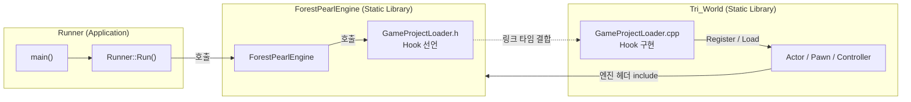

### 객체 계층

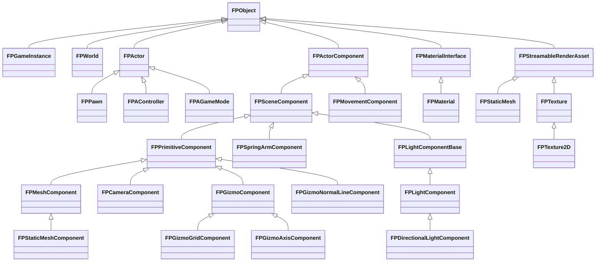

`FPObject`는 `Outer` 포인터로 소유 체인을 형성합니다 (`Actor → World → GameInstance`).
어느 객체에서든 `GetWorld()`를 호출하면 Outer를 따라 올라가 `FPWorld`를 찾습니다.

### GameInstance SubSystem

`FPGameInstance`는 싱글톤이며, 게임 실행 중 하나만 존재해야 하는 시스템 13개를 배열로 보관합니다.
접근 방법은 모두 같습니다.

```cpp
FPAssetLoader* AssetLoader =
    static_cast<FPAssetLoader*>(FPGameInstance::Get().GetAssetLoader());
```

| SubSystem | Getter | 역할 |
|---|---|---|
| `FPGameTimer` | `GetGameTimer()` | `QueryPerformanceCounter` 기반. `DeltaTime()`(초), `DeltaTimeMS()`, `TotalTime()`, `Start/Stop/Reset` |
| `FPGameProjectClassRegistry` | `GetClassRegister()` | `Register<T>("이름")`, `Create("이름")`, `HasFactory("이름")`. 이름은 **클래스 이름과 동일**해야 함 ([등록 규칙](#클래스-등록-규칙)) |
| `FPInputSystem` | `GetInputSystem()` | Raw Input / XInput 수집, 입력 큐 |
| `FPAssetManager` | `GetAssetManager()` | Mesh · VertexBuffer(Position / Normal / Color / UV) · IndexBuffer · StaticMesh · **Texture** · **Material** · **GameSetting**(`FPGameSettingData`, 전역 1개) · Level · GameMode · Shader 저장소. `AllAssetDataCreate()`로 설명 데이터 → GPU 리소스 일괄 생성 |
| `FPAssetLoader` | `GetAssetLoader()` | **GameSetting JSON** / FBX / Level JSON / StaticMesh JSON / Texture JSON / **Material JSON** / Shader 로딩 (실제 GPU 리소스 생성은 `AllAssetDataCreate()`가 나중에 수행) |
| `FPMeshRenderList` | `GetMeshRenderList()` | 메시 `RenderItem` 등록/해제 |
| `FPGizmoRenderList` | `GetGizmoRenderList()` | 기즈모 `GizmoRenderItem` 등록/해제 |
| `FPMeshNormalRenderList` | `GetNormalRenderList()` | Normal Line `NormalRenderItem` 등록/해제 |
| `FPLightRenderList` | `GetLightRenderList()` | 라이트 `FPLightRenderItem` 등록/해제 |
| `FPTextRenderList` | `GetTextRenderList()` | 텍스트 `UIContextItem` 등록/해제 |
| `FPCameraList` | `GetCameraList()` | `CameraItem` 등록/해제 |
| `FPGameProjectSetting` | `GetGameProjectSetting()` | 윈도우 클래스/타이틀, 창 크기(기본 960×600), 클라이언트 영역 크기, Aspect, **MSAA / AF / FullScreen**(`GameSetting.json`에서 `ProjectSetting()`이 읽어 채움) |
| `FPViewPortClient` | `GetViewPortClient()` | `MainGameViewPort` / `UIViewPort` / `TripleWaySplitViewPort` |

### 엔진 구성 요소 전체 목록

<details open>
<summary><b>코어 · 프레임워크</b></summary>

| 클래스 | 파일 | 설명 |
|---|---|---|
| `ForestPearlEngine` | `ForestPearlEngine.h/.cpp` | 엔진 싱글톤. 윈도우 생성, `WndProc`, 메시지 펌프, `PreInitialize / Initialize / GameLoop / Finalize`, GPU·모니터·VRAM 정보 조회 API, `SetZEnable` |
| `FPGameInstance` | `FPGameInstance.h/.cpp` | SubSystem 보관, `OpenLevel`, World 생명주기 전달 |
| `FPWorld` | `FPWorld.h/.cpp` | Level JSON으로 Actor 생성, `SpawnActor`, `GetController`, `GetAuthGameMode`, `GetGameTimer` |
| `FPAGameMode` | `FPAGameMode.h/.cpp` | `ControllerList`(클래스 이름)로 Controller 생성 후 Tick. 0번이 Player Controller |
| `FPAController` | `FPAController.h/.cpp` | `FPInputComponent` 소유, `Possess / UnPossess / GetPawn`, `AddYaw/Pitch/RollInput`(−180~180 정규화) |
| `FPObject` | `Object/Object.h` | `Outer`, `GetWorld()` |
| `FPActor` | `Object/Actor.h/.cpp` | `RootComponent`, `Initialize / BeginPlay / Tick`, `AttachToActor / AttachToComponent / DetachFromActor`, `SetRootComponent`, World Transform Get/Set |
| `FPPawn` | `Object/FPPawn.h/.cpp` | `PossessedBy / UnPossesed`, `GetController`, `AddControllerYaw/Pitch/RollInput` |
| `FPGameplayStatics` | `Utility/FPGameplayStatics.h/.cpp` | `GetActorOfClass`, `GetAllActorsOfClass`, `GetAllActors` |
| `FPPathManager` | `Utility/FPPathManager.h/.cpp` | 구성(Debug/Release)에 따른 에셋 경로, `StringToWString` |
| `MCLOG` | `MCLOG.h` | `MCLOG(LogMC, "fmt %d", v)` → `Log: [Class::Func] 메시지` |

</details>

<details open>
<summary><b>수학 · 데이터 정의</b></summary>

| 타입 | 파일 | 설명 |
|---|---|---|
| `FPVector2/3/4` | `Define/FPMath.h` | 벡터. `FPVector3`는 `+ - *`, `Length`, `Normalize` |
| `FPQuaternion` | `Define/FPMath.h` | 사원수 곱, `ToEuler`, `Normalize` |
| `FPMatrix` | `Define/FPMath.h` | `DirectX::XMMATRIX` 래퍼. `*`, `MatrixInverse`, `Transpose` |
| 함수 | `Define/FPMath.h` | `DegToRad / RadToDeg / Clamp`, `Rotate / Conjugate / Inverse / FromEuler / AngleAxis`, `NormalizeAxis`, `MatrtixTranslation / MatrixRotationQuaternion / MatrixScaling`, `MatrixLookAtLH / MatrixLookToLH / MatrixPerspectiveFovLH` |
| `FTransform` | `FTransform.h` | Location, Rotation(Euler, Degree), QuaternionRotation, Scale + 각 행렬, `Right / Up / Foraward` |
| 정점 스트림 | `Define/FPDataDefine.h` | `POSITION_VERTEX`(12 byte) · `NORMAL_VERTEX`(12) · `COLOR_VERTEX`(16) · `UV_VERTEX`(8), 인덱스 `INDEX_16BIT` · `INDEX_32BIT`(삼각형 1개). `VERTEX`는 이들을 묶은 조립용 구조체 ([정점 스트림 분리와 Index Buffer](#정점-스트림-분리와-index-buffer)) |
| `Topology` | `Define/FPDataDefine.h` | `TRIANGLELIST`, `TRIANGLESTRIP`, `LINELIST` |
| 데이터 구조체 | `Define/FPDataDefine.h` | `FPMeshData`, `FPStaticMeshData`, `SOCKET_TRANSFORM`, `FPVertexBufferData`, `FPIndexBufferData`, `FPActorData` |
| `FInputValue` | `InputValue.h` | `X, Y, Z, bBool, Float` |

> 좌표계는 **왼손 좌표계, Y-Up, +Z 전방**입니다. 회전 벡터는 `{ Pitch(X), Yaw(Y), Roll(Z) }`이며 단위는 Degree입니다.

</details>

---

## 🔄 엔진 메인 루프

### 진입점

```cpp
// Runners/Runner/Runner.cpp
void Runner::Run()
{
    ForestPearlEngine& FPEngine = ForestPearlEngine::GetGameEngine();

    if (!FPEngine.PreInitialize()) return;   // 부팅
    if (!FPEngine.Initialize())    return;   // 레벨 시작
    FPEngine.GameLoop();                     // 메인 루프
    FPEngine.Finalize();                     // 종료
}
```

### 부팅 순서

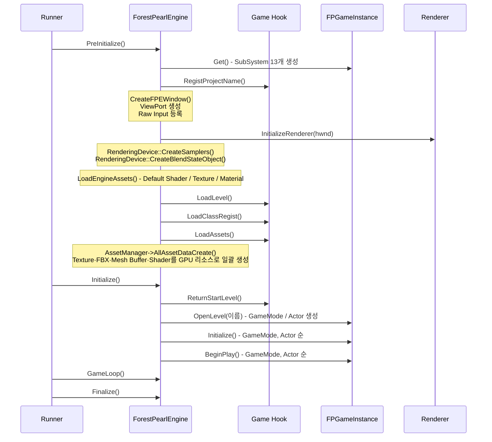

| 단계 | 함수 | 내용 |
|:-:|---|---|
| 1 | `PreInitialize()` | GameInstance 생성 → `RegistProjectName()`(`LoadGameSetting("GameSetting.json")`) → `GameProjectSetting->ProjectSetting()`(창 크기/MSAA/AF/전체화면 반영) → 윈도우 생성 → ViewPort 생성 → Raw Input 등록 → `RenderDevice->SetMSAA/SetAF()` → Renderer 초기화(스왑체인·깊이버퍼가 이 MSAA 값으로 생성) → `CreateSamplers()`(AF 값으로 Anisotropic 샘플러 생성) / `CreateBlendStateObject()` → 엔진 에셋 로드 → `LoadLevel()` → `LoadClassRegist()` → `LoadAssets()` → `AssetManager->AllAssetDataCreate()` |
| 2 | `Initialize()` | `OpenLevel(ReturnStartLevel())` → `World::Initialize()` → `World::BeginPlay()` |
| 3 | `GameLoop()` | 아래 프레임 루프 |
| 4 | `Finalize()` | `World::Finalize()`(Actor 삭제) → `Renderer::Finalize()` |

`FPWorld::OpenLevel`은 Level JSON의 `gamemode` 문자열로 GameMode를 만들고, `actors` 배열의 각 항목을 `ClassRegistry`로 생성해 이름과 Transform을 적용합니다.

> [!IMPORTANT]
> `LoadAssets()`까지는 `Load*()` 함수들이 JSON · FBX를 읽어 **설명 데이터**(`FPTextureInfo` / `FPMaterialData` / `FPStaticMeshData` / `FPVertexShaderData` 등)만 `FPAssetManager`에 쌓아 둡니다. 실제 텍스처 SRV · FBX 메시 버퍼 · 셰이더 바이트코드 같은 **GPU 리소스**는 그 뒤 `AssetManager->AllAssetDataCreate()`가 한 번에 순서대로(Texture → FBX → Mesh Buffer → Vertex/Pixel Shader) 생성합니다. 따라서 `LoadAssets()` 안에서는 **Texture → Material → StaticMesh** 순서로만 호출하면 되고(에셋 사이의 상호 참조는 이름으로만 걸어 둡니다), FBX·셰이더 로드 순서를 신경 쓸 필요가 없습니다.

### 프레임 루프

```cpp
// Engine/ForestPearlEngine/ForestPearlEngine.cpp
void ForestPearlEngine::GameLoop()
{
    while (bEngineLoop)
    {
        if (!MessagePump()) break;      // ① Windows 메시지

        FPGameInstance::Get().Tick();   // ② 게임 로직

        Render->CreateCamList();        // ③ Render List 생성
        Render->CreateLightRenderList();   // CreateMeshRenderList보다 먼저
        Render->CreateMeshRenderList();
        Render->CreateGizmoRenderList();
        Render->CreateNormalRenderList();
        Render->CreateUIRenderList();

        Render->ClearBackBuffer();      // ④ Render Pass
        Render->MeshRenderPass();
        Render->GizmoRenderPass();
        Render->NormalRenderPass();     // bNormal(F6)이 꺼져 있으면 즉시 return
        Render->UIRenderPass();
        Render->RenderTargetPresent();
    }
}
```

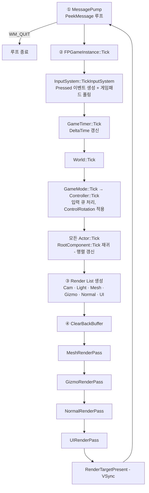

**① 메시지 펌프** — 큐가 빌 때까지 `PeekMessage`로 처리합니다. `WndProc`이 처리하는 메시지는 다음과 같습니다.

| 메시지 | 처리 |
|---|---|
| `WM_NCCREATE` | `lpCreateParams`의 엔진 포인터를 `GWLP_USERDATA`에 저장 |
| `WM_INPUT` | `FPInputSystem::HandleRawInput` |
| `WM_ACTIVATE` | `FPInputSystem::ResetKeyStates` (포커스 전환 시 키 상태 초기화) |
| `WM_SIZE` | 창 크기 갱신 → 모든 ViewPort 재계산 → `Renderer::ResizeRenderTarget` |
| `WM_DESTROY` | `PostQuitMessage(0)` |

**② 게임 로직** — 입력 → 시간 → 월드 순서로 갱신합니다. Controller가 Actor보다 먼저 Tick 되므로, 입력에 의한 이동이 같은 프레임의 행렬 계산에 반영됩니다.

**③ Render List 생성 · ④ Render Pass** — 게임 로직이 끝난 뒤 컴포넌트가 등록해 둔 목록을 값으로 복사하고, Pass 순서대로 그립니다 ([Render Pass](#render-pass) 참고).

> [!IMPORTANT]
> `FPActor::Tick()`이 `RootComponent->Tick()`을 호출해 트랜스폼 행렬을 계산합니다.
> 액터의 `Tick()`을 오버라이드할 때는 반드시 `__super::Tick()`을 호출해야 합니다.

`ForestPearlEngine::StopEngine()`을 호출하면 `bEngineLoop`가 `false`가 되어 루프가 끝납니다.

---

## 🎨 렌더링 구조

### Engine과 Renderer의 관계

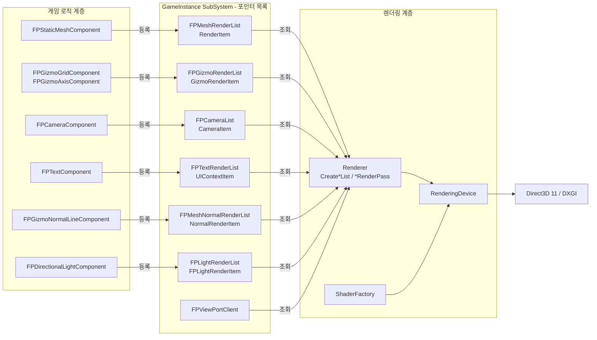

- `ForestPearlEngine`이 `Renderer`와 `RenderingDevice`(싱글톤)를 소유하고, 매 프레임 **Render List 생성 → Render Pass → Present** 순서로 호출합니다.
- **게임 코드는 D3D를 직접 호출하지 않습니다.** 컴포넌트가 생성될 때 자신의 데이터를 가리키는 **포인터 묶음**(`RenderItem` 등)을 목록에 등록하고, 소멸될 때 해제합니다.
- 등록된 항목은 컴포넌트 멤버의 **주소**를 담고 있으므로, 컴포넌트가 값을 바꾸면 별도 제출 과정 없이 다음 프레임에 반영됩니다.
- `Renderer`는 프레임마다 이 포인터 목록을 읽어 **값 복사본(스냅샷)** 인 Render List를 만들고, Render Pass는 그 복사본만 사용합니다.
- VertexBuffer, Shader, InputLayout 같은 GPU 리소스는 엔진 계층에서 `void*`로 다루고, `RenderingDevice` 내부에서만 D3D 타입으로 캐스팅합니다.

| 계층 | 클래스 | 책임 |
|---|---|---|
| 프레임 흐름 | `Renderer` | 초기화 순서, Render List 생성(스냅샷 · 정렬), Render Pass 실행, 상수 버퍼 갱신 호출, 폰트 출력, 리사이즈 |
| 디바이스 | `RenderingDevice` | Device / Context / SwapChain / RTV / DSV / State / Buffer 생성과 바인딩, 상수 버퍼 `Map` 갱신, 하드웨어 정보 |
| 셰이더 | `ShaderFactory` | `.vso` / `.pso` 로드, 런타임 컴파일, InputLayout 생성 |

### Render Pass

한 프레임의 렌더링은 **Render List 생성 → Clear → Render Pass 1 … N → Present** 로 구성됩니다.
Render Pass는 별도 클래스가 아니라 `Renderer`의 멤버 함수이며, **하나의 Pass는 하나의 Render List만 읽어 그립니다.**

```cpp
// Engine/ForestPearlEngine/ForestPearlEngine.cpp
void ForestPearlEngine::GameLoop()
{
    while (bEngineLoop)
    {
        if (!MessagePump()) break;          // ① Windows 메시지
        FPGameInstance::Get().Tick();       // ② 게임 로직

        Render->CreateCamList();            // ③ Render List 생성 (게임 로직이 끝난 뒤의 스냅샷)
        Render->CreateLightRenderList();    // Mesh 목록이 Light 목록을 사용하므로 먼저 생성
        Render->CreateMeshRenderList();
        Render->CreateGizmoRenderList();
        Render->CreateNormalRenderList();
        Render->CreateUIRenderList();

        Render->ClearBackBuffer();          // ④ Render Pass
        Render->MeshRenderPass();
        Render->GizmoRenderPass();
        Render->NormalRenderPass();
        Render->UIRenderPass();
        Render->RenderTargetPresent();
    }
}
```

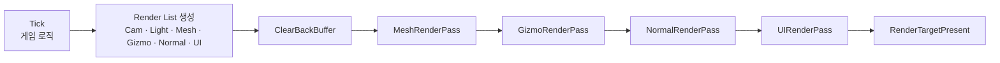

| Pass | 읽는 목록 | Topology | 반복 단위 | 상수 버퍼 | 정렬 |
|---|---|---|---|---|---|
| `MeshRenderPass` | `MeshRenderList` | `TRIANGLELIST` | 카메라 → 메시 → 뷰포트 → 서브 메시 | Object · ViewPort · **Light · Material** (Renderer가 구성, [Light · Normal](#lambert-light--normal-line)) | `Priority` 오름차순 (+ 시작/종료 시 [Alpha Blend](#alpha-blend-초기-구현) 상태 On/Off). Rasterizer(Cull)는 **메시마다** 지정 ([Two Sided](#two-sided-material)) |
| `GizmoRenderPass` | `GizmoRenderList` | `LINELIST` | 카메라 → 기즈모 → 뷰포트 → 서브 메시 | Object · ViewPort · Material | `Priority` 오름차순 |
| `NormalRenderPass` | `NormalRenderList` | `LINELIST` (`DrawInstanced`) | 카메라 → 메시 → 뷰포트 → 서브 메시 | Object · ViewPort · **Normal Matrix** | 없음 (`bNormal`이 `true`일 때만 실행) |
| `UIRenderPass` | `UIRenderList` | (SpriteBatch) | 텍스트 → `UIViewPort` | 사용 안 함 | `Priority` 오름차순 |

- 모든 Pass는 시작할 때 VS / PS 상수 버퍼 14개를 바인딩합니다 ([상수 버퍼](#상수-버퍼)).
- `MeshRenderPass` · `GizmoRenderPass` · `NormalRenderPass`는 시작할 때 Depth Stencil State(`SetZEnable`), Rasterizer State(`SetbFill` / `SetbCull`), Topology를 지정합니다.
- Render List 생성 단계에서 **비활성(`Active = false`) 항목은 제외**됩니다. 따라서 Pass 안에서는 활성 여부를 다시 검사하지 않습니다.
- Render List는 **게임 로직(`Tick`)이 모두 끝난 시점의 값**을 복사합니다. 그려지는 값은 항상 그 프레임 `Tick`의 결과입니다.

| Render List 생성 함수 | 하는 일 |
|---|---|
| `CreateCamList` | `Active`인 카메라만 복사. `TripleCam`이면 `TripleWaySplitViewPort`, 아니면 `MainGameViewPort`를 카메라에 붙이고 ViewPort의 상수 버퍼 데이터도 함께 복사 |
| `CreateMeshRenderList` | `Active`인 `RenderItem`을 값으로 복사(Transform · 셰이더 이름)하고, **라이트(최대 8개)를 메시의 Local 공간으로 변환**해 VS 상수 버퍼에 등록한 뒤 Material(`BaseColor` / `Diffuse` / `Ambient`)을 이어서 등록. `Priority` 오름차순 정렬 |
| `CreateLightRenderList` | `Active`인 라이트를 값으로 복사 (Direction · Range · Diffuse · Ambient · Transform) |
| `CreateGizmoRenderList` | `GizmoRenderItem`에 대해 동일 |
| `CreateNormalRenderList` | `Active`인 `NormalRenderItem`을 복사하고, 오브젝트마다 **Normal Matrix**(`transpose(inverse(World))`)와 `NormalLength`를 VS 상수 버퍼 슬롯 0으로 등록. World 행렬식이 0이거나 비정상이면 해당 항목 제외 |
| `CreateUIRenderList` | `active`인 텍스트만 복사하고 `UIViewPort`를 붙인 뒤 `Priority` 오름차순 정렬 |

#### ⚠️ Render Pass 초기화가 불안정합니다

현재 Render Pass에는 **공통 초기화(Begin) · 종료(End) 단계가 없습니다.** 각 Pass가 자기 함수 맨 앞에서 필요한 상태를 직접 지정하는 방식이며, 이 코드가 Pass마다 복사되어 있습니다. 어떤 상태를 누가 지정하는지가 Pass마다 다르고, 끝난 뒤 상태를 되돌리는 곳도 없어서 **Pass를 추가하거나 순서를 바꾸면 이전 Pass의 상태가 남아 결과가 달라질 수 있습니다.**

| 상태 | `MeshRenderPass` | `GizmoRenderPass` | `NormalRenderPass` | `UIRenderPass` |
|---|:-:|:-:|:-:|:-:|
| 상수 버퍼 14개 바인딩 | ✔ | ✔ | ✔ | ✔ (사용하지 않는데도 바인딩) |
| Depth Stencil State (`ZEnable`) | ✔ | ✔ | ✔ | ✘ |
| Rasterizer State | ✔ (**메시마다**: `bFill`, Cull = `!TwoSided`) | ✔ (`bFill` / `bCull`, Pass 시작 시 1회) | ✔ (`bFill` / `bCull`, Pass 시작 시 1회) | ✘ |
| Topology | `TRIANGLELIST` | `LINELIST` | `LINELIST` | ✘ |
| InputLayout · VS · PS | 항목마다 | 항목마다 | 항목마다 | ✘ (SpriteBatch가 자체 지정) |
| Blend State · RTV / DSV | **✔** (`BS_ADD`, [Alpha Blend](#alpha-blend-초기-구현)) | ✘ | ✘ | ✘ |
| 종료 시 상태 복원 | **✔** (Blend만 `BS_NULL_`로 복원) | ✘ | ✘ | ✘ |

확인된 불안정 요소는 다음과 같습니다.

| 요소 | 내용 |
|---|---|
| **같은 초기화 코드가 Pass마다 복사됨** | 상수 버퍼 14개 바인딩, Depth / Rasterizer / Topology 설정, 슬롯 오프셋(`VS 2`, `PS 1`)과 MVP 상수 버퍼 계산이 Mesh · Gizmo · Normal에 거의 그대로 반복됩니다. 한 곳을 고치고 다른 곳을 놓치기 쉽습니다. 실제로 PS 뷰포트 슬롯 규칙이 Pass마다 달랐던 적이 있습니다 |
| **주석과 실제 동작이 다름** | Gizmo · Normal Pass에도 "MeshRenderPass에서 …"라는 복사된 주석이 남아 있고, 슬롯 오프셋 값의 의미를 코드만으로 알 수 없습니다 |
| **UI Pass는 상태를 지정하지 않음** | Depth · Rasterizer · Topology를 설정하지 않고 `SpriteBatch::Begin()` / `End()`가 바꾸는 상태(Blend · Depth · Rasterizer · Sampler 등)를 그대로 둡니다. 엔진은 이를 복원하지 않으므로 **다음 프레임의 첫 Pass로 상태가 이어집니다.** Depth / Rasterizer는 Mesh Pass가 다시 지정하지만, Blend State는 어떤 Pass도 지정하지 않습니다 |
| **Blend State는 `MeshRenderPass`만 지정** | `MeshRenderPass`는 시작할 때 `OMSetBlendState(BS_ADD)`를 걸고 끝나면 `BS_NULL_`로 되돌리지만, Gizmo · Normal · UI Pass는 Blend State를 전혀 건드리지 않습니다. 메시별 On/Off는 없고 **모든 메시에 일괄 적용**됩니다 ([Alpha Blend](#alpha-blend-초기-구현) 참고). 렌더 타깃(RTV/DSV)은 여전히 초기화와 리사이즈 때 한 번만 바인딩되며, 다른 렌더 타깃을 쓰려면 사용한 뒤 직접 되돌려야 합니다 |
| **IA · PS 슬롯이 해제되지 않음** | Mesh Pass가 바인딩한 Normal(1) · UV(3) 스트림, Index Buffer, 텍스처 `t#`, 샘플러 `s#`는 다음 Pass에도 남습니다. Gizmo Pass는 슬롯 1 · 3을 바인딩하지 않으므로 Mesh Pass가 남긴 버퍼가 그대로 걸려 있는 상태로 같은 Input Layout을 사용합니다 |
| **28개 상수 버퍼를 모든 Pass가 공유** | 같은 버퍼가 Pass마다 다른 의미로 쓰입니다 (VS `b2`: Mesh는 Light, Normal은 Normal Matrix, Material은 그 뒤 슬롯). 한 Pass가 쓰지 않은 슬롯에는 **이전 Pass의 값이 남아** 있습니다 |
| **`Normal` Pass만 조기 반환이 있음** | `bNormal`이 `false`면 상수 버퍼 바인딩 전에 바로 반환합니다. 다른 Pass는 항상 전체 초기화를 수행하므로 Pass마다 진입 동작이 일관되지 않습니다 |
| **Depth · Fill · Cull이 전역** | `ZEnable` · `bFill` · `bCull`이 Mesh · Gizmo · Normal에 똑같이 적용되어, 기즈모만 깊이 테스트를 끄거나 와이어프레임 없이 그리는 식의 Pass별 설정이 불가능합니다 |

**Pass를 만들거나 수정할 때의 규칙**

1. Pass 함수 **맨 앞에서 필요한 상태를 모두 직접 지정**합니다 (Depth · Rasterizer · Topology · 사용하는 IA 슬롯). 이전 Pass가 설정해 두었을 것이라고 가정하지 않습니다.
2. 사용하지 않는 상수 버퍼 · 텍스처 · 샘플러 슬롯은 셰이더가 읽지 않도록 합니다. 읽는다면 그 Pass에서 값을 먼저 써 넣습니다.
3. 기본 상태와 다른 상태(Blend, 렌더 타깃, 다른 Topology 등)를 쓰는 Pass는 끝날 때 **직접 원래대로 되돌립니다.**
4. 공통 초기화를 고칠 때는 Mesh · Gizmo · Normal 세 곳을 함께 확인합니다.

#### 새 Render Pass 추가 순서

1. `Renderers/FPRenderingCommon.h`에 게임 쪽 포인터 Item, `RenderingData::` 값 Item, 정렬 비교자를 추가합니다.
2. Item을 담을 목록 SubSystem을 추가합니다 (예: `FPGizmoRenderList`).
3. `Renderer`에 `CreateXxxRenderList()`와 `XxxRenderPass()`를 추가합니다.
4. `GameLoop()`에서 원하는 순서에 호출합니다. 먼저 호출된 Pass가 먼저 그려집니다.

#### Alpha Blend (초기 구현)

`RenderingDevice::CreateBlendStateObject()`가 Blend State 2종을 만들어 두고(`FPBlendingStateType`: `BS_DEFAULT` — Blend Off, `BS_ADD` — 표준 알파 블렌드, `BS_NULL_` — 해제용 `nullptr`), `ForestPearlEngine::PreInitialize()`가 `CreateSamplers()` 직후에 호출합니다. `MeshRenderPass`는 메시를 그리기 **전**에 `Device.OMSetBlendState(BS_ADD)`로 블렌드를 켜고, 모든 메시를 그린 **뒤** `BS_NULL_`로 되돌립니다. 기본 `DefaultPixelShader.psh`도 함께 바뀌어 `col.a = tex.a;`로 텍스처의 알파 채널을 그대로 출력에 반영합니다.

```hlsl
// b(2 + N)의 BlendOp/Src/Dest — 실제로는 RenderingDevice::CreateBlendStateObject()에서 D3D11_BLEND_DESC로 지정
// 결과색 = Src.Color * Src.a + Dest.Color * (1 − Src.a)   (+ AlphaToCoverage 활성화)
```

> [!NOTE]
> 이름은 `BS_ADD`지만 실제 혼합 공식은 **가산(Additive)이 아니라 표준 Over 알파 블렌드**(`SrcAlpha` / `InvSrcAlpha`)입니다. 커밋 메모에도 남아 있듯 **아직 초기 구현**입니다.
> - Blend On/Off가 **메시 단위가 아니라 `MeshRenderPass` 전체**에 걸립니다. 알파 1인(완전 불투명) 메시도 함께 블렌드 상태로 그려집니다.
> - **Z-Order(뒤→앞 정렬)가 없습니다.** `Priority` 오름차순 정렬은 유지되지만 이는 블렌드용 거리 정렬이 아니므로, 겹치는 반투명 메시의 전후 관계가 틀릴 수 있습니다.
> - Gizmo · Normal · UI Pass는 Blend State를 건드리지 않으므로 영향이 없습니다.

### 렌더러에 전달되는 데이터

```cpp
// Renderers/FPRenderingCommon.h  ── 게임 → 렌더러 (포인터 묶음)
struct RenderItem            // Mesh용. Material 색을 포인터로 직접 들고 있음
{
    int*  Priority;   bool* Active;
    std::string* MeshPath;                              // AssetManager의 VertexBuffer · IndexBuffer 키
    FPMatrix* Location; FPMatrix* Rotation; FPMatrix* Scale;
    std::string* VertexShaderPath; std::string* PixelShaderPath;   // Material의 셰이더 이름
    FPVector4* BaseColor; FPVector4* Diffuse; FPVector4* Ambient;  // Material 색 (렌더러가 VS 상수 버퍼로 조립)
    std::unordered_map<int, FPTextureItem>* TextureList;           // Material의 텍스처 슬롯 목록 (슬롯 → 이름 · SamplerType 포인터)
    FPConstantBufferRenderData* VertexConstBuffer;      // 현재 MeshRenderPass는 읽지 않음 (아래 참고)
    FPConstantBufferRenderData* PixelConstBuffer;
};

// GizmoRenderItem : RenderItem에서 색 포인터(BaseColor / Diffuse / Ambient)가 빠진 구조. 상수 버퍼 데이터를 그대로 사용
// NormalRenderItem: Active, MeshPath, NormalLength*, Location / Rotation / Scale, 셰이더 이름 (상수 버퍼는 렌더러가 생성)

struct FPLightRenderItem     // 라이트 1개
{
    bool* Active;
    FPVector3* Direction;  float* Range;
    FPVector4* Diffuse;    FPVector4* Ambient;
    FPMatrix* Location; FPMatrix* Rotation; FPMatrix* Scale;
};

struct CameraItem            // 카메라 1개
{
    FPMatrix* Location; FPMatrix* Rotation; FPMatrix* Scale;
    FPMatrix* View;     FPMatrix* Projection;
    bool* Active;       bool* TripleCam;
};

struct UIContextItem         // 텍스트 1줄
{
    int* Priority; bool** active; int* x; int* y; FPVector4* color;
    std::basic_string<TCHAR>* msg;
};

struct FPViewPort            // 뷰포트 1개
{
    float TopLeftX, TopLeftY, Width, Height, MinDepth, MaxDepth;
    FPConstantBufferRenderData* VertexConstBuffer;      // 뷰포트 상수 버퍼 데이터
    FPConstantBufferRenderData* PixelConstBuffer;
};
```

`MeshRenderItem`은 값 복사본에 `TextureList`(슬롯 · 텍스처 이름 · 샘플러)와 `SamplerList`(`s#` 배정)를 추가로 가집니다 ([Texture](#texture)).

렌더러는 위 항목을 `RenderingData::MeshRenderItem` · `GizmoRenderItem` · `NormalRenderItem` · `LightRenderItem` · `CameraItem` · `UIContextItem` · `FPViewPort`로 **값 복사**해 Render List에 보관합니다.
메시 / 기즈모 / Normal Line은 `MeshPath`로 `FPAssetManager`에서 스트림별 VertexBuffer 목록과 IndexBuffer 목록을, 셰이더 이름으로 VS · PS · InputLayout을 찾아 사용합니다.

### 초기화 (`Renderer::InitializeRenderer`)

| 순서 | 호출 | 내용 |
|:-:|---|---|
| 1 | `SetDisplayMode` | 클라이언트 영역 크기, `R8G8B8A8_UNORM` |
| 2 | `CreateFactory` | `CreateDXGIFactory2` (Debug 구성은 Debug 플래그) |
| 3 | `CreateHighSpecDevice` | 어댑터를 열거해 소프트웨어 어댑터를 제외하고 **전용 VRAM이 가장 큰 GPU** 선택. Feature Level 11.1 → 11.0 |
| 4 | `CreateSwapChain` | `CreateSwapChainForHwnd`, `SampleDesc = { dwAA, 0 }`(`SetMSAA()`로 미리 설정된 값, 기본 4), 창 모드, VSync 60Hz |
| 5 | `SetBackBufferToRenderTargetView` | BackBuffer → RenderTargetView |
| 6 | `CreateDepthStencil` | `D32_FLOAT`, `SampleDesc = { dwAA, 0 }`(스왑체인과 동일한 MSAA 값이어야 함) |
| 7 | `OMSetRenderTargets` | RTV + DSV 바인딩 |
| 8 | `GetDeviceInfo` | Feature Level 문자열, 어댑터 / 모니터 / VRAM 정보 수집 |
| 9 | `CreateSpriteBatch / CreateSpriteFont` | DirectXTK. 게임 에셋의 `Font/굴림9k.sfont` 사용 |
| 10 | `CreateDepthStencilStateCreate` | `DEPTH_ON` / `DEPTH_OFF` / `DEPTH_WRITE_OFF` |
| 11 | `RasterStateCreate` | `SOLID` / `WIREFRAME` / `CULLBACK` / `WIRECULLBACK` (CCW가 앞면). `MultisampleEnable` / `AntialiasedLineEnable`을 `true`로 설정해 MSAA를 활성화 |
| 12 | `CreateVertexShaderConstBuffer(320)`<br/>`CreatePixelShaderConstBuffer(320)` | 320 byte 상수 버퍼를 **VS 14개 · PS 14개** 생성 후 `b0 ~ b13`에 바인딩 |

### 상수 버퍼

#### 구조

| 항목 | 내용 |
|---|---|
| 개수 | VS용 14개 + PS용 14개 (`b0 ~ b13`). VS와 PS의 번호 체계는 **서로 독립** |
| 크기 | 버퍼 1개당 **320 byte** 고정 (`D3D11_USAGE_DYNAMIC`, CPU Write) |
| 바인딩 | 초기화 때, 그리고 **모든 Render Pass 시작 때** 14개 전부 VS / PS에 바인딩 |
| 갱신 | `Map(WRITE_DISCARD)` → `memcpy(Buffer + Offset, Size)` → `Unmap` |
| 데이터 보관 | `FPConstantBufferRenderData` — 바이트 배열 `Buffer` + 슬롯 목록 `ConstantBuffers[]` (`{ Slot, Offset, Size }`) |

```cpp
// Renderers/FPConstantBufferCommon.h
struct FPConstantBufferInfo       { unsigned int Slot; size_t Offset; size_t Size; };
struct FPConstantBufferRenderData { std::vector<uint8_t> Buffer; std::vector<FPConstantBufferInfo> ConstantBuffers; };

namespace FPConstantBufferRenderDataUtil
{
    template<typename T> void AddConstantBuffer   (FPConstantBufferRenderData&, unsigned int Slot, const T& Data);  // 생성자에서 등록
    template<typename T> void UpdateConstantBuffer(FPConstantBufferRenderData&, unsigned int Index, const T& Data); // 값 갱신
}
```

- **Material**(`FPMaterial`)은 `VertexConstantBuffer` / `PixelConstantBuffer`를 멤버로 가지며, 메시 · 기즈모 컴포넌트가 이 주소를 `RenderItem`에 연결합니다.
- **ViewPort**(`FPViewPortClient`)도 같은 형식의 상수 버퍼 데이터를 가집니다.
- 상수 버퍼는 구조체의 **바이트 복사본**을 보관합니다. `Add`는 등록 시점의 값을, `Update`는 호출 시점의 값을 복사합니다.

#### 슬롯 규약

| 셰이더 | 레지스터 | 소유 | 내용 | 갱신 단위 |
|:-:|:-:|---|---|---|
| VS | `b0` | **엔진 예약** (Object) | `World`, `View`, `Proj`, `WV`, `WVP` (5 × 64 = 320 byte) | 오브젝트 × 뷰포트 |
| VS | `b1` | **엔진 예약** (ViewPort) | 뷰포트의 Vertex 상수. 기본 구조체 `VertexConst { AniOn, BlendOn }` | 뷰포트 |
| VS | `b2 ~ b13` | **Material** (Gizmo) / **Renderer** (Mesh, Normal) | Gizmo: Material의 Vertex 상수, 등록 슬롯 `k` → `b(2 + k)`.<br/>Mesh: `b2 ~ b(1+N)` = Light N개(최대 8), 바로 다음 `b(2+N)` = Material 색.<br/>Normal: `b2` = Normal Matrix + 길이 ([Light · Normal](#lambert-light--normal-line)) | 오브젝트 |
| PS | `b0` | **엔진 예약** (ViewPort) | 뷰포트의 Pixel 상수 (`Slot k` → `b(k)`). 현재 엔진 기본 뷰포트는 사용하지 않음 | 뷰포트 |
| PS | `b1 ~ b13` | **Material** (Gizmo) | Material의 Pixel 상수. 등록 슬롯 `k` → `b(1 + k)`. Mesh · Normal Pass는 PS 상수를 등록하지 않음 | 오브젝트 |

Material이 `AddConstantBuffer`로 등록하는 `Slot`은 셰이더 레지스터 번호가 **아니라** 위 표의 "Material 영역 안에서의 상대 번호"입니다.

| Material 등록 슬롯 | 0 | 1 | 2 | … | `k` | 최댓값 |
|---|:-:|:-:|:-:|:-:|:-:|:-:|
| VS 레지스터 | `b2` | `b3` | `b4` | … | `b(2+k)` | `k = 11` → `b13` |
| PS 레지스터 | `b1` | `b2` | `b3` | … | `b(1+k)` | `k = 12` → `b13` |

> [!WARNING]
> **`MeshRenderPass`는 `FPMaterial`의 `VertexConstantBuffer` / `PixelConstantBuffer`를 더 이상 사용하지 않습니다.** `CreateMeshRenderList`가 Light와 Material 색(`BaseColor` / `Diffuse` / `Ambient`)으로 VS 상수 버퍼를 새로 구성하기 때문입니다.
> 따라서 커스텀 Material에 `AddConstantBuffer`로 등록한 값은 **Gizmo Pass에서만** 셰이더에 전달됩니다 ([커스텀 Material과 상수 버퍼](#8-커스텀-material과-상수-버퍼) 참고).

> [!NOTE]
> ViewPort용 PS 상수 버퍼는 `MeshRenderPass`와 `GizmoRenderPass` 모두 `b(Slot)`으로 갱신됩니다. 따라서 PS `b0`은 ViewPort가, `b1`부터는 Material이 사용해 서로 겹치지 않습니다.
> 뷰포트 상수 버퍼는 엔진 영역이므로 게임 코드에서 추가하지 마세요. 현재 엔진 기본 뷰포트는 VS `b1`만 사용하고 PS 상수 버퍼는 등록하지 않습니다.

`World = Scale × Rotation × Location`, `WVP = World × View × Proj` 로 CPU에서 계산해 `b0`에 전달합니다. 행렬은 전치 없이 전달되므로 셰이더에서는 `mul(mWVP, pos)` 순서로 사용합니다 ([`DefaultVertexShader.vsh`](Engine/ForestPearlEngine/Assets/Shader/DefaultVertexShader.vsh) 참고).

#### 갱신 흐름

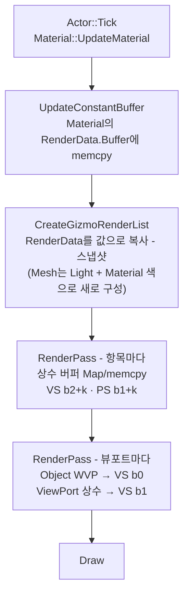

> [!NOTE]
> 엔진은 `UpdateMaterial()`을 **자동으로 호출하지 않습니다.** 값이 매 프레임 바뀌는 Material은 액터의 `Tick()`에서 직접 호출해야 합니다.

콘텐츠 프로그래머가 Material에서 상수 버퍼를 다룰 때의 규칙은 [커스텀 Material과 상수 버퍼](#8-커스텀-material과-상수-버퍼)를 참고하세요.

### 메시 · 기즈모 렌더링 (`MeshRenderPass` / `GizmoRenderPass`)

두 Pass는 Topology(`TRIANGLELIST` / `LINELIST`)와 읽는 목록만 다르고 구조가 같습니다.

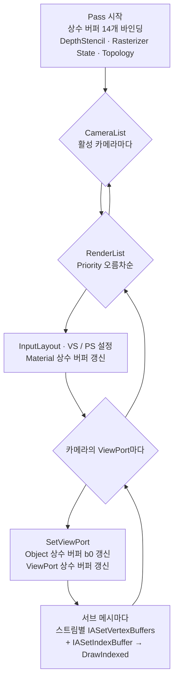

- **텍스처** — `MeshRenderPass`는 항목마다 Material 상수 버퍼 갱신 뒤 텍스처 슬롯을 `PSSetShaderResources(t#)`, 샘플러를 `PSSetSamplers(s#)`로 바인딩합니다 (Gizmo · Normal Pass는 해당 없음).
- **정렬** — `Priority` **값이 작은 항목부터** 그려집니다 (`std::sort` 오름차순). 메시 · 기즈모 컴포넌트의 `SetPriority(int)`로 지정합니다.
- **Fill / Cull** — `bFill`은 `ForestPearlEngine::SetbFill(bool)`로 바꾸는 전역 값입니다. **Cull은 Pass마다 다릅니다.** `MeshRenderPass`는 메시마다 `UpdateRSSetState(bFill, !TwoSided)`를 호출하므로 `SetbCull`(<kbd>F4</kbd>)의 영향을 받지 않고 Material의 `TwoSided`로 결정됩니다. `GizmoRenderPass` · `NormalRenderPass`는 여전히 `bFill` · `bCull` 전역 값으로 Pass 시작 시 한 번 지정합니다.
- **Draw** — Mesh Pass는 Index Buffer로 `DrawIndexed(Index_Cnt, 0, 0)`을, Gizmo Pass는 인덱스 없이 `Draw(VB_Cnt, 0)`을, Normal Pass는 `DrawInstanced(2, VB_Cnt, 0, 0)`을 호출합니다. FBX 로딩 시 코너마다 만든 정점은 `ufbx_generate_indices`로 중복을 병합합니다 ([정점 스트림 분리와 Index Buffer](#정점-스트림-분리와-index-buffer)).
- **깊이 테스트** — `ForestPearlEngine::SetZEnable(bool)`로 전역 On/Off.
- **카메라** — 활성 카메라를 모두 순회하며, 카메라마다 Render List 전체를 다시 그립니다.
- **Material 상수 버퍼는 항목당 한 번**, **Object · ViewPort 상수 버퍼는 뷰포트마다** 갱신됩니다.

### 뷰포트 (`FPViewPortClient`)

| 이름 | 개수 | 용도 |
|---|:-:|---|
| `MainGameViewPort` | 1 | 기본 게임 화면 |
| `UIViewPort` | 1 | 텍스트 UI. 항상 클라이언트 영역 전체 |
| `TripleWaySplitViewPort` | 3 | 3분할 화면. `FPCameraComponent::OnTripleCam()`으로 전환. 뷰포트마다 다른 상수(`AniOn`, `BlendOn`)를 VS `b1`로 전달 |

게임 뷰포트는 기준 화면비(960:600)를 유지하도록 계산되며, 창의 긴 축 방향으로 분할·중앙 정렬됩니다.

### Lambert Light · Normal Line

한 프레임에서 Light와 Normal Line이 어떻게 만들어지고 그려지는지 정리합니다.

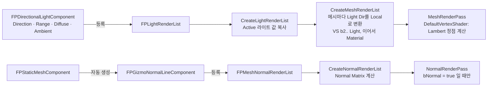

#### Lambert Light

| 항목 | 내용 |
|---|---|
| 컴포넌트 | `FPDirectionalLightComponent`(`FPLightComponentBase` → `FPLightComponent` 상속). 생성 시 `FPLightRenderList`에 등록. `SetDirection / SetRange / SetDiffuse / SetAmbient / SetActive` |
| 기본값 | Direction `(0, 1, 0)`, Range `1000`, Diffuse `(1,1,1,1)`, Ambient `(0.2,0.2,0.2,1)` |
| 계산 위치 | **정점 셰이더**(정점 단위). 픽셀 셰이더는 보간된 색을 출력할 뿐입니다 |
| 방향 공간 | **Local(오브젝트) 공간.** 엔진이 메시마다 `Direction`을 정규화 → `World` 역행렬을 곱해 로컬로 바꾼 뒤 다시 정규화해 전달합니다. 셰이더는 모델의 노멀(`NORMAL`)을 변환하지 않고 그대로 `dot(N, L)`에 사용합니다 |
| 라이트 개수 | 활성 라이트 중 **최대 8개**를 메시마다 상수 버퍼 `LIGHT`로 등록 (`Direction`, `Range`, `Diffuse`, `Ambient`) |
| Material | `FPMaterial`의 `BaseColor` · `Diffuse` · `Ambient`. `RenderItem`이 값의 주소를 들고 있고, 렌더러가 Light 다음 슬롯에 `MATERIAL`로 등록합니다 |
| 노멀 | `NORMAL_VERTEX`(`nx, ny, nz`) 스트림(Input Slot 1)에 저장됩니다. FBX 로딩 시 노드의 `node_to_world`로 변환 후 정규화해 저장합니다 |

```hlsl
// LambertLight.hlsli
float4 Diff = max(dot(N, L), 0) * LightDiffuse * MaterialDiffuse;
float4 Amb  = LightAmbient * MaterialAmbient;
return saturate(Diff + Amb);                       // 최종 색 = Material.BaseColor * 이 값
```

```hlsl
// DefaultVertexShader.vsh — 상수 버퍼 배치 (라이트 1개일 때)
cbuffer ObejctConstBuffer     : register(b0) { matrix mWorld, mView, mProj, mWV, mWVP; };
cbuffer ViewPortConstBuffer   : register(b1) { };
cbuffer DirectionLightConstBuffer : register(b2) { LIGHT Light; };      // 라이트 k → b(2 + k)
cbuffer MaterialConstBuffer   : register(b3) { MATERIAL Material; };    // Material → b(2 + 라이트 수)
```

> [!IMPORTANT]
> Material 슬롯 위치가 **라이트 수에 따라 달라집니다.** 기본 셰이더는 라이트 1개를 전제로 `b2` = Light, `b3` = Material을 선언합니다. 라이트가 0개이면 Material이 `b2`로 올라오고, 2개 이상이면 `b4` 이후로 밀립니다. 라이트 수가 달라질 수 있다면 셰이더도 맞춰 수정해야 합니다.

```cpp
// Games/Release_Game/Tri_World/ADirectionalLight.cpp
ADirectionalLight::ADirectionalLight()
{
    LightComponent = new FPDirectionalLightComponent(this);
    FPVector3 Dir{ 0.43f, -0.64f, 0.64f };            // 정규화된 방향 (Tri_World)
    LightComponent->SetDirection(Dir);
}
```

Level JSON에 `"class": "ADirectionalLight"`로 배치하며, 클래스는 `LoadClassRegist()`에서 등록해야 합니다. 메시 색은 `Mesh->GetMaterial().SetBaseColor(Color)`로 지정합니다.

#### Normal Line

| 항목 | 내용 |
|---|---|
| 컴포넌트 | `FPGizmoNormalLineComponent`. **`FPStaticMeshComponent`가 생성자에서 자동으로 만들어** 같은 메시 · 같은 Transform으로 `FPMeshNormalRenderList`에 등록합니다. `SetActive`, `SetNormalLength(float)` |
| 토글 | `ForestPearlEngine::SetbNormal(bool)` → `Renderer::bNormal`. `false`이면 `NormalRenderPass`가 바로 반환합니다 (Tri_World: <kbd>F6</kbd>) |
| Render Pass | `NormalRenderPass` — `MeshRenderPass` 다음, `GizmoRenderPass` 다음에 호출. Topology `LINELIST` |
| 그리는 방식 | 메시의 **정점 1개 = 인스턴스 1개**. Input Layout의 `POSITION`(슬롯 0) · `NORMAL`(슬롯 1)을 `PER_INSTANCE_DATA`로 읽고 `DrawInstanced(2, 정점 수, 0, 0)`으로 선 1개(정점 2개)를 그립니다. 정점 수는 병합된 **고유 정점 수**(`VB_Cnt`)이며 Index Buffer는 사용하지 않습니다 |
| 선의 양끝 | `SV_VertexID`가 0이면 시작점(정점 위치), 1이면 끝점(`시작점 + WorldNormal * NormalLength`) |
| Normal Matrix | CPU(`CreateNormalRenderList`)에서 `transpose(inverse(World))`를 계산해 VS `b2`로 전달(`mNormal`, `NormalLength`, `NormalSign`). 셰이더의 `TransformWorldNormal()`이 이 행렬로 노멀을 월드로 변환하고 정규화합니다. World 행렬식이 0이면 그 항목은 그리지 않습니다 |
| 색 | 앞면 노멀은 초록 `(0, 1, 0, 1)`, **뒷면 노멀은 주황 `(1, 0.5, 0, 1)`** — `NormalDebugVertexShader`가 `NormalSign`으로 결정 |
| 뒷면 노멀 | `CreateNormalRenderList`가 메시 항목 하나당 `NormalRenderItem`을 **두 번** 등록합니다. 첫 번째는 `NormalSign = +1`(앞면, 초록), 두 번째는 `NormalSign = -1`(노멀 반대 방향, 주황)이며 선 끝점은 `WorldNormal * NormalLength * NormalSign`입니다. 따라서 Normal Line 항목 수와 Draw 수가 두 배가 됩니다 |
| 기본 길이 | `NormalLength = 1.0` |

```hlsl
// NormalDebugVertexShader.vsh
cbuffer NormalDebugConstBuffer : register(b2) { matrix mNormal; float NormalLength; };

float3 WorldPosition = mul(mWorld, float4(input.Position, 1.0f)).xyz;
float3 WorldNormal   = TransformWorldNormal(input.Normal, mNormal);
if (input.VertexID == 1) WorldPosition += WorldNormal * NormalLength;
```

> [!NOTE]
> 셰이더 에셋 로드는 `EngineLoader.h`의 `LoadEngineAssets()`가 처리합니다 (`DefaultGizmo*`, `NormalDebug*` 포함). Normal Line 전용 VS는 Input Layout이 다르므로 `LoadVertexShader` 대신 `LoadNormalDebugVertexShader`로 로드합니다.

### UI 렌더링 (`Renderer::UIRenderPass`)

`UIRenderList`의 텍스트마다 `SpriteBatch::Begin()` → `UIViewPort`를 설정하고 `SpriteFont::DrawString()` → `End()` 순으로 출력합니다. 상수 버퍼는 사용하지 않습니다.

### 리사이즈 (`Renderer::ResizeRenderTarget`)

`WM_SIZE` → RenderTarget 바인딩 해제 → RTV / DepthStencil 해제 → `ResizeBuffers` → RTV / DepthStencil 재생성 → 재바인딩

### 셰이더와 Material

| 항목 | 내용 |
|---|---|
| 입력 레이아웃 | 속성마다 **별도 슬롯, 오프셋 0** — `POSITION`(float3, 슬롯 0), `NORMAL`(float3, 슬롯 1), `COLOR`(float4, 슬롯 2), `TEXCOORD`(float2, 슬롯 3). Normal Line 셰이더만 `POSITION`(0) · `NORMAL`(1)을 **Per-Instance**로 읽음 |
| 기본 Mesh 셰이더 | `DefaultVertexShader.vso` — WVP 변환 + **Lambert Light를 정점 단위로 계산**(`b0` Object, `b2` Light, `b3` Material). `DefaultPixelShader.pso`는 보간된 정점 색에 **텍스처(`t0` / `s0`)를 곱해** 출력 |
| 기본 Gizmo 셰이더 | `DefaultGizmoVertexShader.vso` / `DefaultGizmoPixelShader.pso` — WVP 변환 후 정점 색 출력 (`b0`만 사용, 라이트 없음). Position · Color 스트림만 바인딩. `FPGizmoGridComponent` · `FPGizmoAxisComponent`가 사용 |
| Normal Line 셰이더 | `NormalDebugVertexShader.vso` / `NormalDebugPixelShader.pso` — [Lambert Light · Normal Line](#lambert-light--normal-line) 참고. 전용 Input Layout을 쓰므로 `LoadNormalDebugVertexShader()`로 로드 |
| 로드 방식 1 | 사전 컴파일된 오브젝트 로드 — `LoadVertexShader("X.vso", owner)` |
| 로드 방식 2 | 런타임 컴파일 — `LoadVertexShader("X.fx", "VS_Main", "vs_5_0", owner)` (행 우선 행렬 패킹) |
| `FPMaterialInterface` | `SetTexture / SetTextureSampler / AddTexture / DeleteTexture / GetTextureList`, `SetTwoSided / GetTwoSided`, `SetVertexShader / SetPixelShader`, 셰이더 이름 Getter, `Set / GetBaseColor · Diffuse · Ambient`, `Get{Vertex,Pixel}ConstantBufferRenderData()`, `UpdateMaterial(DeltaTime)` |
| `FPMaterial` | 생성 시 **텍스처 슬롯 0**(`Default_Texture512`)과 기본 셰이더 이름, `BaseColor` · `Diffuse` · `Ambient`(기본 모두 `{1,1,1,1}`)를 설정. 보호 멤버 `VertexConstantBuffer` / `PixelConstantBuffer`에 `AddConstantBuffer`로 상수 버퍼를 등록 (Gizmo Pass에서만 사용) |

Material은 셰이더를 **파일 이름**(`"Demo.vso"`)으로 가리키고, 렌더러가 Pass 안에서 `FPAssetManager`에서 실제 셰이더를 찾습니다. 따라서 `LoadAssets()`에서 먼저 로드해 두어야 합니다.

Material 선택 우선순위: **컴포넌트 생성 뒤 `SetMaterial`로 직접 지정한 Material** → StaticMesh JSON의 `"Material.Name"`이 가리키는 [Material JSON](#material-json)(`MakeMaterial`이 자동 생성) → 그 이름이 없으면 엔진의 `DefaultMaterial`

### 정점 스트림 분리와 Index Buffer

메시의 정점 데이터는 하나의 `VERTEX` 배열 대신 **속성별 스트림 4개 + Index Buffer 1개**로 나뉘어 GPU에 올라갑니다.

| 스트림 | 구조체 | 크기 | Input Slot | 시맨틱 |
|---|---|:-:|:-:|---|
| Position | `POSITION_VERTEX { x, y, z }` | 12 byte | 0 | `POSITION` |
| Normal | `NORMAL_VERTEX { nx, ny, nz }` | 12 byte | 1 | `NORMAL` |
| Color | `COLOR_VERTEX { r, g, b, a }` | 16 byte | 2 | `COLOR` |
| UV | `UV_VERTEX { u, v }` | 8 byte | 3 | `TEXCOORD` |
| Index | `INDEX_32BIT { A, B, C }` (삼각형 1개) | 12 byte | — | `DXGI_FORMAT_R32_UINT` |

Input Layout은 시맨틱마다 **슬롯이 다르고 오프셋은 모두 0**입니다 (`ShaderFactory::CreateInputLayout`). HLSL의 시맨틱(`POSITION`, `NORMAL`, `COLOR0`, `TEXCOORD0`) 선언은 바뀌지 않았으므로 기존 셰이더는 그대로 사용할 수 있습니다.
`VERTEX`(`PositionVertex` · `NormalVertex` · `ColorVertex` · `UVVertex` · `Index`)는 Gizmo 정점을 만들 때 쓰는 **조립용 구조체**이며, GPU에는 속성별로 분해되어 올라갑니다.

#### FBX 로딩과 Index 생성

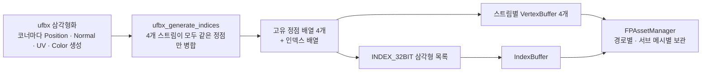

- 위치 · 노멀 · UV · 컬러 **네 값이 모두 같은 정점만** 하나로 합쳐집니다. 노멀이나 UV가 다른 모서리는 합쳐지지 않으므로 정점 수는 줄지만 하드 에지는 유지됩니다.
- 메시 노드 하나가 서브 메시 하나이며, 서브 메시마다 스트림 4개와 Index Buffer가 `FPAssetManager`에 같은 순서로 쌓입니다. 렌더 Pass는 같은 인덱스 `i`로 꺼내 씁니다.
- 변환할 정점이 없는 메시는 빈 데이터로 반환됩니다.

#### 데이터 구조체

```cpp
// Define/FPDataDefine.h
struct FPVertexBufferData { void* VertexBuffer; unsigned long VB_Size /*byte*/, VB_Cnt /*정점 수*/; unsigned int Stride, Offset; };
struct FPIndexBufferData  { void* IndexBuffer;  unsigned long Index_Size /*byte*/, Index_Cnt /*인덱스 수 = FaceCnt*3*/, FaceCnt; unsigned int Stride, Offset; };

struct FPMeshData { std::string Name;
    std::vector<POSITION_VERTEX> Position_Vertices;  std::vector<NORMAL_VERTEX> Normal_Vertices;
    std::vector<COLOR_VERTEX>    Color_Vertices;     std::vector<UV_VERTEX>     UV_Vertices;
    std::vector<INDEX_32BIT>     Index; };
```

| `FPAssetManager` | 설명 |
|---|---|
| `AddPositionVertexBuffer` · `AddNormalVertexBuffer` · `AddColorVertexBuffer` · `AddUVVertexBuffer` · `AddIndexBuffer` | 경로(FBX 경로 · Gizmo 이름)별로 서브 메시 순서대로 추가 |
| `GetPositionVertexBuffer` · `GetNormalVertexBuffer` · `GetColorVertexBuffer` · `GetUVVertexBuffer` · `GetIndexBuffer` | 경로의 서브 메시 목록 반환 |
| `HasPositionBuffer` · `HasNormalBuffer` · `HasColorBuffer` · `HasUVBuffer` · `HasIndexBuffer` | 등록 여부 |

기존 `AddVertexBuffer` · `GetVertexBuffer` · `HasVertexBuffer`는 제거되었습니다. 로더는 `FPAssetLoader::MakePositionVertexBuffer` · `MakeNormalVertexBuffer` · `MakeColorVertexBuffer` · `MakeUVVertexBuffer` · `MakeIndex32BitBuffer`로 GPU 버퍼를 만들며, `RenderingDevice`에는 `CreateIndexBuffer`, `IASetIndexBuffers`, `DrawIndexed`가 추가되었습니다. `MakeIndex16BitBuffer`(`INDEX_16BIT`)도 정의되어 있지만 Index Buffer 포맷은 `R32_UINT`로 고정되어 있어 현재 쓰이지 않습니다.

#### Pass별 사용

| Pass | 바인딩하는 스트림 | 그리기 |
|---|---|---|
| `MeshRenderPass` | Position(0) · Normal(1) · Color(2) · UV(3) · Index | `DrawIndexed(Index_Cnt, 0, 0)` |
| `GizmoRenderPass` | Position(0) · Color(2) (Index 없음) | `Draw(VB_Cnt, 0)` — 선 목록을 인덱스 없이 그림 |
| `NormalRenderPass` | Position(0) · Normal(1) (Index는 바인딩만 하고 사용하지 않음) | `DrawInstanced(2, VB_Cnt, 0, 0)` — 정점마다 인스턴스 1개 |

> [!NOTE]
> - Gizmo Pass는 Normal(1) · UV(3) 슬롯을 바인딩하지 않지만 Mesh와 같은 Input Layout을 사용합니다. 셰이더가 읽지 않는 슬롯이므로 문제는 없습니다.
> - Draw 호출에는 바이트 수(`VB_Size`)가 아니라 **정점 수(`VB_Cnt`)** 를 넘겨야 합니다. 새 Pass를 만들 때 주의하세요.
> - Normal Pass가 `DrawInstanced`를 쓰는 이유는 정점마다 선을 하나 그리는 구조이기 때문입니다. 병합된 정점의 노멀은 모두 같으므로 정점 하나당 선 하나가 됩니다.

#### 콘텐츠 프로그래머가 알아둘 점

- 메시를 쓰는 코드(`FPStaticMeshComponent`, StaticMesh JSON, `LoadFbxData`)는 **바뀐 것이 없습니다.** 스트림 분리와 Index 생성은 로더가 처리합니다.
- 직접 만든 셰이더는 시맨틱(`POSITION` · `NORMAL` · `COLOR0` · `TEXCOORD0`) 이름만 맞추면 됩니다. 전용 Input Layout이 필요한 셰이더(예: Normal Line)는 `ShaderFactory`에서 슬롯 배치를 함께 맞춰야 합니다.
- 새 Gizmo를 만들 때는 `FPGizmoComponent::MakeVertexBuffer`가 만드는 `VERTEX` 중 **Position과 Color만** 사용됩니다.
- 인덱스는 삼각형 단위(3개씩)로 만들어지므로 FBX 메시는 `TRIANGLELIST`로 그려야 합니다.

### Texture

텍스처는 **에셋 로드 → Material 슬롯 → Render List → `MeshRenderPass`의 PS 바인딩** 순서로 전달됩니다. 현재는 `MeshRenderPass`(메시)만 텍스처를 바인딩합니다. Gizmo · Normal Pass는 사용하지 않습니다.

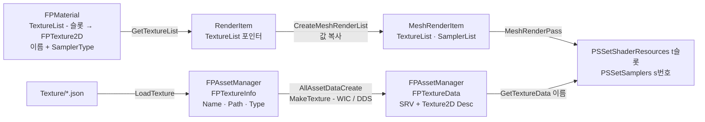

| 구성 요소 | 파일 | 설명 |
|---|---|---|
| `FPTexture` / `FPTexture2D` | `FPTexture.h`, `FPTexture2D.h/.cpp` | Material 슬롯 1개가 가지는 값. **텍스처 이름**(`FPAssetManager` 키)과 `FPSamplerType` |
| `FPTextureInfo` | `FPAssetManager.h` | `LoadTexture`가 JSON에서 읽은 **설명 데이터**(`Name` / `Path` / `Type` / `Owner`). 이 시점에는 아직 GPU 리소스가 없음 |
| `FPTextureData` | `Define/FPDataDefine.h` | `MakeTexture`가 만든 실제 텍스처. `TextureResource`(`ID3D11ShaderResourceView*`), `TextureDESC`(`D3D11_TEXTURE2D_DESC*`) |
| `FPTextureItem` | `Renderers/FPRenderingCommon.h` | `RenderItem`이 Material의 텍스처 목록을 가리키는 포인터 묶음 (`std::string* TexturePath`, `FPSamplerType* SamplerType`) |
| `RenderingData::FPTextureItem` · `FPSamplerItem` | `Renderers/FPRenderingCommon.h` | Render List의 값 복사본. `{ Slot, 텍스처 이름, SamplerType }`, `{ Slot, SamplerType }` |
| `FPAssetManager` | `FPAssetManager.h/.cpp` | `AddTextureInfoData` · `GetTextureInfoData` · `HasTextureInfoData`(설명 데이터), `MakeTexture`(GPU 리소스 생성), `AddTextureData` · `GetTextureData` · `HasTextureData`(생성된 텍스처) |
| `FPAssetLoader::LoadTexture` | `AssetLoader.cpp` | Texture JSON을 읽어 `FPTextureInfo`로 등록 (실제 `WIC` / `DDS` 로드는 `AllAssetDataCreate()`가 나중에 수행) |
| `RenderingDevice` | `RenderingDevice.h/.cpp` | `CreateWICTextureFromFile` · `CreateDDSTextureFromFile`(DirectXTK, **Mipmap 자동 생성**), `GetTextureDesc`, `PSSetShaderResources`, `CreateSamplers`, `PSSetSamplers` |

#### 바인딩 규칙

| 대상 | 규칙 |
|---|---|
| 텍스처 슬롯 | Material에 등록한 슬롯 `n` → PS **`t(n)`**. 슬롯은 `0 ~ 127`만 허용 |
| 기본 슬롯 | `FPMaterial` 생성자가 **슬롯 0**을 자동 등록 (`Default_Texture512`, Clamp). 슬롯 0은 항상 존재 |
| 샘플러 번호 | 텍스처 슬롯과 **1:1이 아닙니다.** Render List를 만들 때 그 메시가 쓰는 샘플러 종류를 `FPSamplerType` 값 오름차순으로 중복 없이 모아 `s0, s1, …`에 차례로 배정합니다 |
| 갱신 시점 | `CreateMeshRenderList`에서 `Active`인 메시의 텍스처 · 샘플러 목록을 복사하고, `MeshRenderPass`가 **메시마다** `PSSetShaderResources` / `PSSetSamplers`를 호출 |

샘플러 번호 예: 슬롯 0 = `Filter_Tri_Linear_Sampler_Wrap`, 슬롯 1 = `Filter_Tri_Linear_Sampler_CLAMP`이면 → `s0` = CLAMP, `s1` = Wrap (열거형 순서). 한 메시가 샘플러를 하나만 쓰면 항상 `s0`입니다.

`FPSamplerType`은 **필터 4단계 × 주소 모드 9종 = 36개** 값입니다 (`Sampler_MAX_`가 전체 개수). JSON에서는 `TextureFilter`(필터)와 `SamplerType`(주소 모드)을 따로 쓰고, `StringToSamplerType`이 `TextureFilter + "_" + SamplerType`으로 합쳐 아래 열거형 이름을 찾습니다. 못 찾으면 **기본값 `Filter_Tri_Linear_Sampler_CLAMP`** 로 떨어집니다.

| 필터(`TextureFilter`) | D3D11 필터 | 비고 |
|---|---|---|
| `Filter_Point` | `MIN_MAG_MIP_POINT` | |
| `Filter_Bi_Linear` | `MIN_MAG_LINEAR_MIP_POINT` | |
| `Filter_Tri_Linear` | `MIN_MAG_MIP_LINEAR` | **기본값**. Mipmap 보간까지 사용 |
| `Filter_Anistropy_Linear` | `ANISOTROPIC`, `MaxAnisotropy = dwAF` | `dwAF`는 `GameSetting.json`의 `AnisotropicFiltering` 값 |

| 주소 모드(`SamplerType`) | D3D11 주소 모드 | 비고 |
|---|---|---|
| `Sampler_CLAMP` | Clamp | 기본값 |
| `Sampler_Wrap` | Wrap | 타일링 |
| `Sampler_Mirror` | Mirror | |
| `Sampler_Mirror_Once` | Mirror Once | |
| `Sampler_Border` | Border(흰색) | |
| `Sampler_BorderColor_RED` / `BLUE` / `GREEN` / `MAGENTA` | Border | 범위 밖 UV는 해당 색 |

실제 enum 값은 두 이름을 이어붙인 `Filter_Tri_Linear_Sampler_CLAMP`, `Filter_Anistropy_Linear_Sampler_Wrap` 같은 형태입니다 (`Renderers/FPRenderingCommon.h`).

> [!IMPORTANT]
> 샘플러 상태 객체 36개는 `RenderingDevice::CreateSamplers()`가 만들며, `ForestPearlEngine::PreInitialize()`에서 `Renderer::InitializeRenderer()` **직후**, 엔진 에셋 로드(`LoadEngineAssets`) 전에 호출합니다.
> 이 함수는 `ID3D11Device`로 `CreateSamplerState`를 호출하므로 **D3D 디바이스가 만들어진 뒤**(`InitializeRenderer`의 `CreateHighSpecDevice` 이후)여야 합니다. 앞으로 부팅 순서를 바꿀 때도 이 순서를 지켜야 합니다.
> Anisotropic 샘플러의 `MaxAnisotropy`는 `RenderingDevice::SetAF()`로 미리 설정해 둔 `dwAF` 값을 쓰므로, **`SetAF()` → `CreateSamplers()`** 순서를 지켜야 합니다 (`ForestPearlEngine::PreInitialize()`가 이 순서로 호출).
> 호출되지 않으면 `PSSetSamplers`가 `nullptr`을 바인딩해, `SetTexture(…, SamplerType)`로 고른 샘플러가 반영되지 않습니다.

> [!NOTE]
> **Mipmap** — `CreateWICTextureFromFile` / `CreateDDSTextureFromFile`은 이제 `ID3D11DeviceContext`를 함께 넘겨 `D3D11_RESOURCE_MISC_GENERATE_MIPS`로 로드하므로, 텍스처를 로드할 때 Mip 체인이 자동 생성됩니다. `Filter_Tri_Linear_*` / `Filter_Anistropy_Linear_*` 샘플러가 실제로 Mip 보간 효과를 받습니다.

#### 기본 셰이더

`DefaultVertexShader`는 `TEXCOORD0`을 `o.uv`로 넘기고, `DefaultPixelShader`는 정점 색에 텍스처를 곱해 출력합니다. [Alpha Blend](#alpha-blend-초기-구현) 추가 이후로는 텍스처의 알파 채널을 출력 알파로 그대로 내보냅니다.

```hlsl
Texture2D    TexDiff : register(t0);   // Material 텍스처 슬롯 0
SamplerState Smpler  : register(s0);   // 사용 중인 샘플러 중 가장 앞선 종류

float4 PS_Main(float4 pos : SV_POSITION, float4 col : COLOR0, float2 uv : TEXCOORD0,
               bool IsFrontFace : SV_IsFrontFace) : SV_TARGET   // Cull이 꺼진(TwoSided) 메시의 앞/뒷면 판별용
{
    float4 tex = TexDiff.Sample(Smpler, uv);
    float4 col2 = col * tex;
    col2.a = tex.a;         // 출력 알파 = 텍스처 알파 (Alpha Blend용)
    return col2;
}
```

`IsFrontFace`는 입력으로 선언만 되어 있고 기본 PS는 아직 이 값으로 노멀을 뒤집지 않습니다 (뒷면 노멀 처리는 정점 셰이더의 Lambert 계산에 반영되어야 하며 구현은 진행 중입니다). 따라서 텍스처를 지정하지 않은 메시는 `Default_Texture512`가 곱해집니다. 기본 텍스처는 엔진이 `LoadEngineAssets()`에서 로드하며, `Checker_bmp`(WIC) · `Checker_dds`(DDS)도 함께 제공됩니다.

#### 텍스처 에셋

`FPAssetLoader::LoadTexture(name, file, owner)`는 `Texture/<file>`(JSON)을 읽어 `FPTextureInfo`로 등록합니다. 실제 이미지는 `TextureResource/`에서 `AllAssetDataCreate()`가 로드합니다.

```json
{
  "Name": "Hair_png",
  "Path": "hair.png",
  "Type": "WIC"
}
```

| 키 | 설명 |
|---|---|
| `Name` | 등록 이름. Material JSON의 `Texture[].Name`이 이 이름을 참조 |
| `Path` | `TextureResource/` 기준 이미지 파일 |
| `Type` | `"WIC"` — bmp · png · jpg 등 WIC가 읽는 형식 / `"DDS"` — DDS 파일 |

- 이미 같은 이름이 등록되어 있으면 로드하지 않고 콘솔에 메시지를 출력합니다.
- 파일 열기 · 이미지 로드 실패는 콘솔에만 출력되고 계속 진행됩니다. 실패한 텍스처는 `nullptr` 리소스로 남습니다.
- `Tool/DXTexViewer/DxTex.exe`로 이미지를 DDS로 변환하고 확인할 수 있습니다 (`d3dx9_*.dll` 포함).
- [`Tool/FBXToStaticMeshJsonTranslator`](#fbx-변환-도구-fbxtostaticmeshjsontranslator)는 FBX에 연결된 텍스처마다 이 JSON을 **자동 생성**합니다 (같은 이미지 파일은 한 번만).

### 셰이더 JSON

셰이더도 JSON으로 **등록**합니다. `FPAssetLoader::LoadVertexShader(file, owner)` / `LoadPixelShader(file, owner)`가 `Shader/<file>`을 읽어 `FPVertexShaderData` / `FPPixelShaderData`로 `FPAssetManager`에 보관하고, Material JSON의 `VertexShader` / `PixelShader`가 이 `Name`으로 셰이더를 가리킵니다.

```json
// Shader/TerrainVertexShader.json
{ "Name": "TerrainVertexShader", "Path": "TerrainVertexShader.vso", "InputLayout": "Default" }

// Shader/TerrainPixelShader.json  (Pixel Shader는 InputLayout 없음)
{ "Name": "TerrainPixelShader", "Path": "TerrainPixelShader.pso" }
```

| 키 | 설명 |
|---|---|
| `Name` | 등록 이름. Material JSON의 `VertexShader` / `PixelShader` 값 |
| `Path` | 컴파일된 셰이더 파일. Debug는 `ShaderResource/bin/`, Release는 `ShaderResource/` 기준 |
| `InputLayout` | (Vertex Shader만) `"Default"` 등 사용할 Input Layout 이름 |

- HLSL 소스(`*.vsh` / `*.psh` / `*.hlsli`)는 `ShaderResource/`에 두고, 게임 프로젝트의 **FxCompile** 항목으로 `ShaderResource/bin/%(Filename).vso|pso`에 컴파일되도록 설정합니다 (`Debug|x64`와 `Release|x64` 모두 진입점 `VS_Main` / `PS_Main`, Shader Model 5.0).
- 새 셰이더는 `LoadAssets()`에서 **셰이더 → 텍스처 → Material → StaticMesh** 순서로 등록합니다.

### Material JSON

Material도 Texture처럼 **JSON으로 정의되는 에셋**입니다. `FPAssetLoader::LoadMaterial(name, owner)`가 `Material/<file>`을 읽어 `FPMaterialData`(설명 데이터)로 등록해 두면, `AllAssetDataCreate()` 이후 **StaticMesh가 실제로 생성되는 시점**(`FPAssetManager::GetStaticMeshData`)에 `MakeMaterial(이름)`이 이를 실제 `FPMaterial` 인스턴스로 변환합니다. 등록된 이름이 없으면 엔진 에셋 `DefaultMaterial`로 대체됩니다.

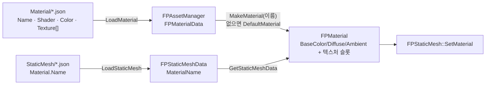

실무에서는 재질 하나를 **기본 Material**(색만, 재질당 1개)과 **Material Instance**(메시마다 1개, 기본 색을 복제 + 이 메시가 쓰는 텍스처 배열)로 나눠서 두 JSON을 만들고, StaticMesh JSON은 Material Instance 쪽을 참조합니다 ([FBX 변환 도구](#fbx-변환-도구-fbxtostaticmeshjsontranslator)가 자동으로 이 구조로 생성합니다).

```json
// Material/hair.002_Material.json — 기본 Material (색만)
{
  "Material": {
    "Name": "hair.002_Material",
    "VertexShader": "DefaultVertexShader",
    "PixelShader": "DefaultPixelShader",
    "Ambient":   { "r": 0.05, "g": 0.05, "b": 0.05, "a": 1.0 },
    "BaseColor": { "r": 0.8,  "g": 0.8,  "b": 0.8,  "a": 1.0 },
    "Diffuse":   { "r": 0.8,  "g": 0.8,  "b": 0.8,  "a": 1.0 },
    "TwoSided":  false
  }
}

// Material/hair.002_ToonLink_Hair_StaticMesh_MaterialInstance.json — 이 메시 전용 Instance (+ 텍스처)
{
  "Material": {
    "Name": "hair.002_ToonLink_Hair_StaticMesh_MaterialInstance",
    "VertexShader": "DefaultVertexShader",
    "PixelShader": "DefaultPixelShader",
    "Ambient":   { "r": 0.05, "g": 0.05, "b": 0.05, "a": 1.0 },
    "BaseColor": { "r": 0.8,  "g": 0.8,  "b": 0.8,  "a": 1.0 },
    "Diffuse":   { "r": 0.8,  "g": 0.8,  "b": 0.8,  "a": 1.0 },
    "TwoSided":  false
  },
  "Texture": [
    { "Name": "Hair_png", "Slot": 0, "TextureFilter": "Filter_Tri_Linear", "SamplerType": "Sampler_Wrap" }
  ]
}
```

| 키 | 설명 |
|---|---|
| `Material.Name` | 등록 이름. StaticMesh JSON의 `Material.Name`과 다른 Material JSON이 이 이름으로 서로 참조 |
| `Material.VertexShader` / `PixelShader` | `FPAssetManager`에 로드돼 있어야 하는 셰이더 이름 (확장자 없이) |
| `Material.Ambient` / `BaseColor` / `Diffuse` | `FPMaterial::SetAmbient/BaseColor/Diffuse`로 그대로 전달되는 `{r,g,b,a}` 색 |
| `Material.TwoSided` | 양면 렌더링 여부. 생략하면 `false`. `true`이면 `MeshRenderPass`가 이 메시를 Cull 없이 그림 ([Two Sided Material](#two-sided-material)) |
| `Texture[]` | `{ Name, Slot, TextureFilter, SamplerType }` 배열. `AssetLoader`가 `TextureFilter + "_" + SamplerType`을 합쳐 `FPSamplerType`으로 변환하고, `MakeMaterial`이 각 항목마다 `AddTexture(Slot)` + `SetTexture(Slot, Name, SamplerType)`를 호출 (생략하면 텍스처 없는 기본 Material). `TextureFilter` / `SamplerType`을 생략하거나 조합이 열거형에 없으면 기본값 `Filter_Tri_Linear_Sampler_CLAMP`로 떨어짐 ([Texture](#texture) 참고) |

> [!IMPORTANT]
> `LoadAssets()`에서는 **Texture → Material → StaticMesh** 순서로 호출해야 합니다. `MakeMaterial`이 `Texture[].Name`을 그대로 `FPMaterial`에 박아 두고, 실제 조회(`GetTextureData`)는 `MeshRenderPass`가 그릴 때 일어나기 때문에 느슨하게라도 이 순서를 지키는 편이 안전합니다.
> 데이터 기반 Material은 항상 **기본 `FPMaterial`** 클래스로 생성됩니다. 상수 버퍼를 추가로 쓰는 [커스텀 Material 서브클래스](#8-커스텀-material과-상수-버퍼)가 필요하면 `GetStaticMeshData`가 만든 Material을 가져오는 대신, 컴포넌트 생성 직후 `SetMaterial()`로 직접 교체해야 합니다.

### Legacy 렌더러

`Renderers/Legacy/`에는 DX11 렌더러 이전 단계의 구현이 보존되어 있습니다 (현재 솔루션에는 포함되지 않음).

| 폴더 | 내용 |
|---|---|
| `FPRHI/` | `FPRHI`, `FPRHIDevice`, `FPRHIVertexBuffer` 추상 인터페이스 (DX9 스타일 API) |
| `GDI/` | GDI 백엔드 |
| `DirectX/` | `DXRHI` 백엔드 |
| `Mia/`, `MIARHI/` | 소프트웨어 렌더러 MIA와 RHI 어댑터 |
| `DOHWA/`, `DOHWARHI/` | 소프트웨어 렌더러 DOHWA(圖畵署)와 RHI 어댑터 |
| `Legacy_Renderer.h/.cpp` | FPRHI를 사용하는 렌더러 |

---

## 🎮 Input 시스템

Unreal Engine의 Enhanced Input과 비슷한 **Mapping Context → Input Action → Binding** 구조입니다.

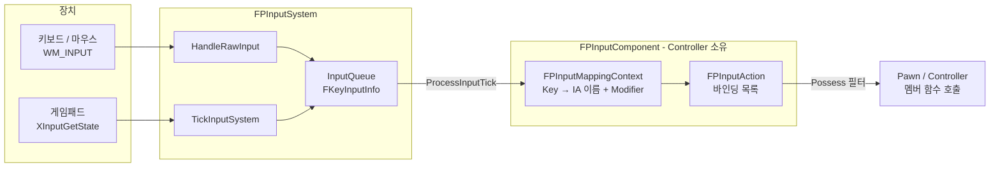

### 1. 수집 — `FPInputSystem`

| 장치 | 수집 방식 | 발생 이벤트 |
|---|---|---|
| 키보드 | `WM_INPUT` → `HandleKeyboardInput` | 상태 변화 시 `Down` / `Up`. 운영체제 키 반복 입력은 무시 |
| 키보드(누르고 있음) | `TickInputSystem` | `Pressed` 바인딩이 있는 키에 한해 매 프레임 `Pressed` 생성 |
| 마우스 | `WM_INPUT` → `HandleMouseInput` | 좌/우 버튼 `Down` · `Up`, 휠 버튼 `Down`. 값은 커서 위치를 800×600 기준 −1~1로 정규화한 `X`, `Y` |
| 게임패드 | `TickInputSystem` → `HandleGamepadInput` | 0번 컨트롤러. 버튼 `Down` / `Pressed` / `Up`, 스틱·트리거는 `Pressed` |

모든 이벤트는 하나의 구조체로 큐에 쌓입니다.

```cpp
struct FKeyInputInfo
{
    USHORT      VKey;        // 가상 키 코드 (게임패드는 0x100 이상)
    EKeyState   KeyState;    // None / Down / Pressed / Up
    FInputValue InputValue;  // X, Y, Z, bBool, Float
};
```

**게임패드 키 코드 (`XBOX_GAMEPAD`)**

| 코드 | 이름 | 값 |
|:-:|---|---|
| `0x100` | `GAMEPAD_LSTICK` | `X`, `Y` = −1 ~ 1 (데드존 0.1) |
| `0x101` | `GAMEPAD_RSTICK` | `X`, `Y` = −1 ~ 1 (데드존 0.1) |
| `0x102` ~ `0x105` | `GAMEPAD_A` / `B` / `X` / `Y` | `X` = 1 |
| `0x106` / `0x107` | `GAMEPAD_LEFT_SHOULDER` / `RIGHT_SHOULDER` | `X` = 1 |
| `0x108` / `0x109` | `GAMEPAD_START` / `BACK` | `X` = 1 |
| `0x10A` ~ `0x10D` | `GAMEPAD_DPAD_UP` / `DOWN` / `LEFT` / `RIGHT` | `X` = 1 |
| `0x10E` / `0x10F` | `GAMEPAD_LEFT_THUMB` / `RIGHT_THUMB` (스틱 클릭) | `X` = 1 |
| `0x110` / `0x111` | `GAMEPAD_LEFT_TRIGER` / `RIGHT_TRIGER` | `X` = 0 ~ 1 (임계값 초과 시) |

### 2. 매핑 — `FPInputMappingContext`

키 하나를 Input Action 이름과 Modifier에 연결합니다.

```cpp
GetInputComponent().AddMappingKey("IA_Move", 'W', { ESwizzle::YZX, ENegative::Positive });
```

| Modifier | 값 | 효과 |
|---|---|---|
| `ESwizzle` | `XYZ` | 그대로 |
| | `YZX` | `X → Y`, `Y → Z`, `Z → X` (1축 키 입력을 Y축 값으로 사용) |
| | `ZXY` | `X → Z`, `Y → X`, `Z → Y` |
| `ENegative` | `Positive` / `Negative` | `Negative`이면 값에 −1을 곱함 |

- 여러 키를 하나의 Input Action에 매핑할 수 있습니다 (예: W·A·S·D → `IA_Move`).
- **키 하나는 하나의 Input Action에만** 매핑됩니다. 같은 키를 다시 매핑하면 먼저 등록한 매핑이 유지됩니다.

### 3. 바인딩 — `FPInputAction`

```cpp
Controller->GetInputComponent().BindMethod(
    "IA_Move",            // Input Action 이름
    this,                 // 대상 객체
    EKeyState::Pressed,   // 호출 조건: Down / Pressed / Up
    &Player::Move);       // void (T::*)(FInputValue)
```

- 하나의 Input Action에 여러 객체의 함수를 바인딩할 수 있습니다.
- `Pressed`로 처음 바인딩하는 순간, 해당 Action에 매핑된 키들이 "누름 감시 목록"에 등록됩니다. **매핑(`AddMappingKey`)을 바인딩보다 먼저** 해야 합니다.

### 4. 처리 — `FPInputComponent::ProcessInputTick`

매 프레임 `FPAController::Tick()`에서 큐를 비우며 이벤트마다 다음을 수행합니다.

1. `VKey`로 Mapping Context 검색 → Input Action 이름 + Modifier
2. Input Action의 바인딩 순회
3. **Possess 필터** — 바인딩 대상이 *현재 Possess 중인 Pawn* 또는 *Controller 자신*일 때만 통과
4. `KeyState`가 바인딩의 호출 조건과 같을 때만 통과
5. Modifier(Negative → Swizzle) 적용 후 함수 호출

### 5. Possess

```cpp
Controller->Possess(Pawn);     // 이전 Pawn은 자동으로 UnPossess
Controller->UnPossess();
FPPawn* Pawn = Controller->GetPawn();
```

여러 Pawn이 같은 Input Action에 바인딩되어 있어도 **Possess 중인 Pawn만** 입력을 받습니다.
`AddControllerYawInput / PitchInput / RollInput`으로 누적한 Controller 회전은 `bUsePawnControlRotation = true`인 SpringArm이 사용합니다.

---

## 📦 Assets 구조

### 에셋 루트

에셋은 **엔진 에셋**과 **게임 에셋** 두 루트로 나뉘며, 로딩 함수의 `AssetOwner` 인자로 구분합니다.

| 구성 | 게임 에셋 루트 (`AssetOwner::User`) | 엔진 에셋 루트 (`AssetOwner::Engine`) | 컴파일된 셰이더 |
|---|---|---|---|
| Debug | `../../Games/Release_Game/<프로젝트명>/Assets` | `../../Engine/ForestPearlEngine/Assets` | `<루트>/ShaderResource/bin/` |
| Release | `Assets` (exe 옆) | `Assets` (exe 옆) | `<루트>/ShaderResource/` |

Debug 경로는 작업 디렉터리(`Runners/Runner`) 기준 상대 경로입니다. `<프로젝트명>`은 `FPPathManager::Get().Initialize("Tri_World")`로 지정합니다.

### 폴더 규칙

```text
Assets/
├── GameSetting/   GameSetting.json       창 크기 · MSAA · AF · 전체화면 (게임 에셋 루트 고정, `AssetOwner` 구분 없음)
├── Font/          *.sfont               DirectXTK SpriteFont (굴림9k.sfont 필수)
├── Level/         *.json                레벨 = GameMode + Actor 배치
├── Model/         <모델>/*.fbx          원본 메시 (StaticMesh JSON이 Name/NodeName으로 참조)
├── StaticMesh/    *_StaticMesh.json     메시 + Topology + Socket + Material(참조)
├── Material/      *_Material.json       기본 Material + *_MaterialInstance.json (색 + 텍스처 배열)
├── Texture/       *.json                텍스처 정의 (이미지 경로 + 로드 방식)
├── TextureResource/ *.dds *.bmp …       이미지 원본 (DxTex로 DDS 변환 가능)
├── Shader/        *.json                셰이더 등록 정보 (Name · Path · InputLayout)
└── ShaderResource/ *.vsh *.psh *.hlsli  HLSL 소스
    └── bin/       *.vso *.pso           컴파일 결과 (빌드 시 생성)
```

| 로더 함수 | 기준 폴더 | 예 |
|---|---|---|
| `LoadGameSetting(file)` | `GameSetting/` | `"GameSetting.json"`. `AssetOwner` 인자가 없고 항상 게임 에셋 루트에서 읽음. `RegistProjectName()`에서 다른 `Load*()`보다 먼저 호출 ([GameSetting](#gamesetting) 참고) |
| `LoadStaticMesh(file, owner)` | `StaticMesh/` | `"Tree_StaticMesh.json"` (FBX는 JSON의 `NodeName`으로 `AllAssetDataCreate()`가 자동으로 찾아 로드) |
| `LoadMaterial(file, owner)` | `Material/` | `"hair.002_Material.json"` ([Material JSON](#material-json)) |
| `LoadLevelData(name, file, owner)` | `Level/` | `"TriWorld", "TriWorld.json"` |
| `LoadTexture(file, owner)` | `Texture/`(JSON) → `TextureResource/`(이미지, `AllAssetDataCreate()`가 로드) | `"Checker_dds.json"` |
| `LoadVertexShader(file, owner)` / `LoadPixelShader(file, owner)` | `Shader/`(JSON) → `ShaderResource/bin/`(컴파일된 `.vso` / `.pso`) | `"TerrainVertexShader.json"` ([셰이더 JSON](#셰이더-json)) |

> FBX를 직접 가리키는 로더 함수는 더 이상 없습니다. `FPAssetManager::LoadFbxData(FPStaticMeshData&)`가 **내부용**(비공개)으로 바뀌어, `AllAssetDataCreate()`가 로드된 StaticMesh 설명 데이터마다 자동으로 호출합니다.

### GameSetting

다른 `Load*()`보다 먼저, `RegistProjectName()`에서 `FPAssetLoader::LoadGameSetting("GameSetting.json")`으로 읽습니다. `AssetOwner`가 없고 항상 게임 에셋 루트(`Assets/GameSetting/`)에서 찾습니다.

```json
// Assets/GameSetting/GameSetting.json (Tri_World)
{
  "GameSetting": {
    "GameName": "Tri_World",
    "Graphics": {
      "MSAA": 8,
      "AnisotropicFiltering": 16,
      "Resolution": {
        "Width": 960,
        "Height": 600
      },
      "FullScreen": false
    }
  }
}
```

| 키 | 설명 |
|---|---|
| `GameName` | 창 클래스/타이틀로 쓰임 (`FPGameProjectSetting::WinClassName` / `WinName`) |
| `Graphics.MSAA` | 스왑체인·깊이버퍼 `SampleDesc.Count`. **짝수이고 8 이하**가 아니면 `1`(AA off)로 대체 |
| `Graphics.AnisotropicFiltering` | Anisotropic 샘플러의 `MaxAnisotropy`. **짝수이고 16 이하**가 아니면 `1`로 대체 |
| `Graphics.Resolution.Width` / `Height` | 창 크기(`WinWidth` / `WinHeight`), `DisplayAspect` 계산에도 사용 |
| `Graphics.FullScreen` | 전체화면 여부 (`FPGameProjectSetting::FullScreen`) |

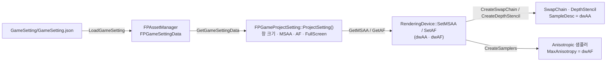

> [!IMPORTANT]
> `RenderDevice->SetMSAA()` / `SetAF()`는 `Renderer::InitializeRenderer()`(스왑체인·깊이버퍼 생성) **전에**, `CreateSamplers()`는 그 **후에** 호출해야 값이 반영됩니다. `ForestPearlEngine::PreInitialize()`가 이미 이 순서로 호출하므로, 부팅 순서를 바꿀 때는 이 제약을 지켜야 합니다.

### 로딩 파이프라인

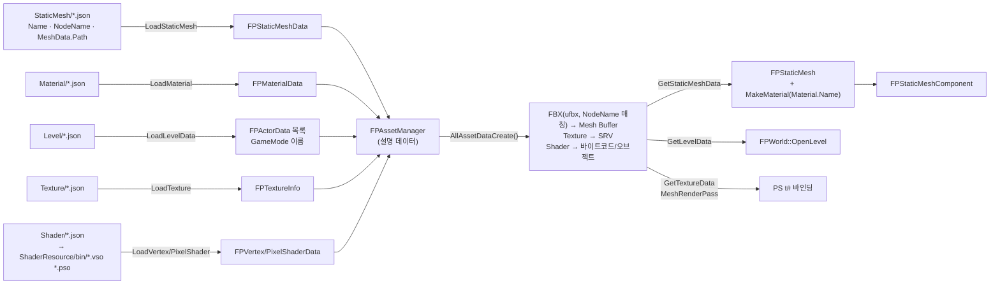

**FBX 변환 규칙** — 왼손 좌표계 · Y-Up · 미터 단위로 로드하고, 모든 면을 삼각형화한 뒤 코너마다 정점을 생성합니다. 정점에는 노드 변환이 적용된 위치 · 노멀 · UV와 Vertex Color가 들어가며(색이 없으면 흰색), 위치 · 노멀 · UV · 컬러가 모두 같은 정점은 병합되어 **Index Buffer**로 참조됩니다. 메시 노드 하나가 서브 메시 하나이며, 서브 메시마다 Position · Normal · Color · UV VertexBuffer와 IndexBuffer가 하나씩 만들어집니다. `LoadFbxData`는 StaticMesh JSON의 `NodeName`과 **이름이 같은 노드**를 FBX 씬 전체에서 찾아 그 노드의 메시만 변환하므로, 같은 FBX 파일 안의 서로 다른 노드를 여러 StaticMesh JSON이 각각 가리킬 수 있습니다 (ToonLink 데모처럼 캐릭터 FBX 하나에서 머리카락 · 눈 · 검 등 서브메시 수십 개를 따로 뽑아 쓰는 구성).

### Level JSON

```json
{
  "gamemode": "GameMode",
  "actors": [
    {
      "class": "Terrain",
      "name": "Ground",
      "transform": {
        "location": { "x": 0.0,   "y": -0.5, "z": 0.0 },
        "rotation": { "x": 0.0,   "y": 0.0,  "z": 0.0 },
        "scale":    { "x": 128.0, "y": 1.0,  "z": 128.0 }
      }
    }
  ]
}
```

| 키 | 설명 |
|---|---|
| `gamemode` | `ClassRegistry`에 등록한 GameMode 클래스 이름 |
| `actors[].class` | `ClassRegistry`에 등록한 Actor 클래스 이름 |
| `actors[].name` | 액터 이름 (`GetName()`으로 조회) |
| `actors[].transform` | World 기준 `location` / `rotation`(Degree) / `scale` |

### StaticMesh JSON

```json
{
  "Name": "ToonLink_Hair_StaticMesh",
  "NodeName": "_043_Gamemodel_",
  "MeshData": [
    { "Path": "ToonLink/ToonLink.fbx", "Topology": "TRIANGLELIST" }
  ],
  "Sockets": [
    {
      "Name": "WingPoint1",
      "Transform": {
        "Location": { "x": 0.0,   "y": 3.0, "z": -1.0 },
        "Rotation": { "x": -90.0, "y": 0.0, "z": 0.0 },
        "Scale":    { "x": 1.0,   "y": 1.0, "z": 1.0 }
      }
    }
  ],
  "Material": {
    "Name": "hair.002_ToonLink_Hair_StaticMesh_MaterialInstance"
  }
}
```

| 키 | 설명 |
|---|---|
| `Name` | 이 StaticMesh의 등록 이름(파일명과 일치시키는 것이 관례). 변환된 메시 버퍼도 이 이름으로 저장됨 |
| `NodeName` | FBX 씬에서 이 메시를 찾을 **노드 이름**. `LoadFbxData`가 전체 노드 중 이름이 같은 것을 찾아 그 메시만 변환 (여러 StaticMesh가 같은 FBX의 다른 노드를 각각 가리킬 수 있음) |
| `MeshData[].Path` | `Model/` 기준 FBX 경로. 배열이지만 **마지막 항목만** 사용됨 |
| `MeshData[].Topology` | `TRIANGLELIST` / `TRIANGLESTRIP` / `LINELIST` |
| `Sockets[]` | 메시 로컬 기준 부착 지점. 비워 둘 수 있음 |
| `Material.Name` | [Material JSON](#material-json)(대개 Material Instance)의 등록 이름. 없는 이름이거나 `Material` 객체 자체가 없으면 엔진의 `DefaultMaterial`을 사용 |

> 이전 버전에서는 `Material`이 `ClassRegistry`에 등록한 **C++ Material 클래스 이름**(문자열)이었습니다. 지금은 위처럼 **Material JSON을 가리키는 객체**로 바뀌었고, C++ 서브클래스가 필요하면 생성된 `FPStaticMeshComponent`에 `SetMaterial()`로 직접 교체해야 합니다.

#### Two Sided Material

Material JSON의 `TwoSided`는 `FPMaterialData` → `FPMaterial::SetTwoSided()` → `RenderItem::TwoSided`(포인터) → `RenderingData::MeshRenderItem::TwoSided`(값 복사)로 전달되어 `MeshRenderPass`에서 쓰입니다.

| 단계 | 내용 |
|---|---|
| 정의 | `Material.TwoSided` (`LoadMaterial`이 `Material.value("TwoSided", false)`로 읽음 — 키가 없으면 `false`) |
| 코드 | `FPMaterialInterface::SetTwoSided(bool)` / `GetTwoSided()`. 런타임에 `Mesh->GetMaterial().SetTwoSided(true)`로도 바꿀 수 있음 |
| 렌더링 | `MeshRenderPass`가 메시마다 `UpdateRSSetState(bFill, !(TwoSided))`를 호출 → **`TwoSided = true`이면 Cull 없음**, `false`이면 뒷면 제거 |
| 전역 Cull | Mesh Pass에서는 `ForestPearlEngine::SetbCull`(<kbd>F4</kbd>)이 더 이상 적용되지 않습니다. Gizmo · Normal Pass만 전역 `bCull`을 따릅니다 |
| 픽셀 셰이더 | `bool IsFrontFace : SV_IsFrontFace` 입력을 받을 수 있음. Tri_World의 Terrain · Tree · WindmillWingBody PS도 같은 시그니처 |
| FBX 변환 도구 | FBX 머티리얼의 `double_sided` 설정을 기본 Material과 Material Instance 양쪽의 `"TwoSided"`로 기록 |
| 디버그 | Normal Line이 뒷면 노멀(주황)을 함께 그림 ([Normal Line](#normal-line)) |

> [!NOTE]
> 커밋 메모에 남아 있듯, 양면 메시에서 **뒷면에 반대 방향 노멀을 쓰는 셰이더 코드는 아직 없습니다.** 지금은 Cull만 꺼지므로 뒷면도 앞면과 같은 노멀로 라이팅됩니다.
> 한 번 바뀐 Rasterizer State가 Pass 안에서 메시마다 다시 지정되므로, 양면 메시가 많으면 상태 변경 횟수가 늘어납니다.

### FBX 변환 도구 (FBXToStaticMeshJsonTranslator)

> 위치: [`Tool/FBXToStaticMeshJsonTranslator`](Tool/FBXToStaticMeshJsonTranslator)

위에서 설명한 StaticMesh / Material / Material Instance / Texture JSON을 사람이 손으로 쓰는 대신, FBX 파일을 그대로 밀어 넣어 한 번에 뽑아내는 **독립 콘솔 툴**입니다. 엔진과 같은 `ufbx` · `nlohmann::json` 라이브러리를 그대로 가져와 쓰며(엔진 본체에는 의존하지 않음), ToonLink 데모 캐릭터의 StaticMesh/Material/Texture JSON 전체가 이 도구로 생성되었습니다.

```text
FBXToStaticMeshJsonTranslator.exe [FBX입력폴더] [Json출력폴더]
# 인자를 생략하면 실행 파일 기준 EXE/FBX, EXE/Json 폴더를 사용
```

| 단계 | 하는 일 |
|---|---|
| FBX 스캔 | 입력 폴더의 모든 `.fbx`를 읽어, **메시를 가진 노드마다** StaticMesh JSON 하나를 생성 (`Name` = 파일명 그대로, `NodeName` = FBX 노드 이름) |
| 소켓 | 메시가 없는 자식 노드(로케이터/더미)는 `Sockets[]`로 변환 |
| Material | 메시에 연결된 첫 머티리얼마다 **기본 Material**(`<재질명>_Material.json`, 재질당 1번만 저장)과 **Material Instance**(`<재질명>_<StaticMesh이름>_MaterialInstance.json`, 메시마다 저장)를 함께 기록. 둘 다 `VertexShader` / `PixelShader`는 FBX에 정보가 없으므로 `DefaultVertexShader` / `DefaultPixelShader`로 채움 |
| Texture | 머티리얼에 연결된 텍스처를 **실제 이미지 파일 기준으로 중복 없이** Texture JSON으로 저장 (DDS면 `"DDS"`, 그 외엔 `"WIC"`). Material Instance의 `Texture[]` 항목에는 FBX 텍스처의 Wrap 설정(Repeat/Clamp)을 `"SamplerType": "Sampler_Wrap"` / `"Sampler_CLAMP"`로, 필터는 FBX에 정보가 없어 항상 `"TextureFilter": "Filter_Tri_Linear"`로 채움 |

- FBX 머티리얼의 **Two Sided(`double_sided`)** 설정이 켜져 있으면 두 Material JSON에 `"TwoSided": true`를 기록합니다 (엔진 `FPMaterial::TwoSided`와 같은 의미).
- 빌드된 실행 파일이 `Tool/FBXToStaticMeshJsonTranslator/EXE/`에 포함되어 있습니다.
- 출력 폴더 아래 `StaticMesh/`, `Material/`, `Texture/` 하위 폴더가 자동으로 만들어집니다.
- 생성된 JSON은 그대로 게임 프로젝트의 `Assets/`에 복사해 쓸 수 있으며, `GameProjectLoader.cpp`의 `LoadAssets()`에서 **Texture → Material → StaticMesh** 순서로 호출만 추가하면 됩니다 (실제 이미지 · FBX 파일도 함께 복사해야 함).
- 엔진 쪽 `FPAssetManager::LoadFbxData`와 **노드 탐색 로직이 일치해야** 같은 결과가 나오므로, FBX 구조를 바꾸는 작업을 할 때는 이 둘을 함께 확인해야 합니다.

---

## 🛠 Build 시스템

### 요구 사항

| 항목 | 내용 |
|---|---|
| IDE | Visual Studio 2022 (Platform Toolset **v143**) |
| 언어 표준 | C++17, Unicode |
| SDK | Windows SDK 10.0 (Direct3D 11, DXGI 1.6, XInput, D3DCompiler) |
| 구성 | `Debug` / `Release` × `x64` / `x86` |

### 솔루션 구성

| 프로젝트 | 유형 | 참조 | 비고 |
|---|---|---|---|
| `Engine/ForestPearlEngine` | Static Library | → **게임 프로젝트** | HLSL 컴파일(FxCompile) 포함 |
| `Runners/Runner` | Application (Console) | → `ForestPearlEngine` | `DirectXTK.lib` 링크, 패키징 타깃 |
| `Games/Release/Tri_World` | Static Library | — | Include 경로 `$(SolutionDir)Engine` |

빌드 순서는 **Tri_World.lib → ForestPearlEngine.lib → Runner.exe** 입니다.
엔진 프로젝트가 게임 프로젝트를 참조하므로, 게임이 구현한 Hook 함수가 최종 실행 파일에 함께 링크됩니다.

### 외부 라이브러리

| 라이브러리 | 위치 | 용도 | 연결 방식 |
|---|---|---|---|
| DirectXTK | `Libraries/DirectXTK` | `SpriteBatch`, `SpriteFont`, `WICTextureLoader`, `DDSTextureLoader` | 헤더 `Inc/`, 라이브러리 `Bin/Desktop_2022/$(Platform)/$(Configuration)/DirectXTK.lib` |
| ufbx | `Libraries/Ufbx` | FBX 로딩 | `ufbx.c`를 엔진에 포함해 컴파일 |
| nlohmann/json | `Libraries/nlohmann` | JSON 파싱 | 헤더 전용 |

### Visual Studio 설정

프로젝트 속성은 저장소의 `.vcxproj`에 이미 들어 있습니다.
**①** 은 clone 후 PC마다 직접 해야 하는 설정이고, **② ~ ⑤** 는 새 게임 프로젝트를 만들거나 설정을 점검할 때 확인하는 항목입니다.

#### ① clone 후 직접 해야 하는 설정

`.vs/`, `*.vcxproj.user`, `**/Bin/`은 git에 포함되지 않으므로 아래 항목은 저장소에 저장되지 않습니다.

| # | 항목 | 설정 방법 |
|:-:|---|---|
| 1 | 워크로드 | Visual Studio Installer → **C++를 사용한 데스크톱 개발** (MSVC v143, Windows 10/11 SDK) |
| 2 | DirectXTK 라이브러리 | `Engine/ForestPearlEngine/Libraries/DirectXTK/DirectXTK_Desktop_2022.sln`을 열어 `Debug\|x64`, `Release\|x64`를 각각 빌드 → `Bin/Desktop_2022/x64/<구성>/DirectXTK.lib` 생성. x86으로 빌드하려면 `Win32` 구성도 빌드 |
| 3 | 시작 프로젝트 | 솔루션 탐색기 → **Runner** 우클릭 → **시작 프로젝트로 설정**. 엔진과 게임은 정적 라이브러리라 실행할 수 없음 |
| 4 | 솔루션 플랫폼 | 도구 모음에서 **x64** 선택. 패키징은 `Release\|x64`에서만 동작 |
| 5 | 디버깅 작업 디렉터리 | Runner 속성 → 디버깅 → 작업 디렉터리 = `$(ProjectDir)` (기본값 유지). Debug 구성은 작업 디렉터리 기준 `../../Games/…`, `../../Engine/…`에서 에셋을 읽음 |
| 6 | 시스템 로캘 | Windows 시스템 로캘 **한국어** 기준. 소스 대부분이 CP949(ANSI)로 저장되어 있고, 렌더러가 `Font/굴림9k.sfont`를 좁은 문자열 경로로 엶 |

> [!CAUTION]
> 프로젝트에 `/utf-8` 컴파일 옵션을 추가하지 마세요. BOM 없는 CP949 소스의 한글 문자열과 주석이 깨집니다.

#### ② 게임 프로젝트 속성

프로젝트 우클릭 → 속성. 구성 **모든 구성**, 플랫폼 **모든 플랫폼**으로 두고 설정합니다.

| 속성 페이지 | 항목 | 값 |
|---|---|---|
| 구성 속성 → 일반 | 구성 형식 | **정적 라이브러리(.lib)** |
| 구성 속성 → 일반 | 플랫폼 도구 집합 | Visual Studio 2022 (v143) |
| 구성 속성 → 일반 | C++ 언어 표준 | ISO C++17 표준 (`/std:c++17`) |
| 구성 속성 → 고급 | 문자 집합 | **유니코드 문자 집합 사용** (엔진 API가 `TCHAR` 문자열을 주고받음) |
| C/C++ → 일반 | 추가 포함 디렉터리 | `$(SolutionDir)Engine` |
| C/C++ → 미리 컴파일된 헤더 | 미리 컴파일된 헤더 | 사용 안 함 |
| 구성 속성 → 일반 | 출력 디렉터리 | 기본값 유지 (x64 기준 `$(SolutionDir)x64\$(Configuration)\`) |

- 프로젝트 위치는 `Games/Release_Game/<이름>/<이름>.vcxproj` 이어야 합니다.
- **폴더 이름 = 프로젝트 이름 = `FPPathManager::Get().Initialize("<이름>")`** 을 모두 같게 맞춥니다. 프로젝트 이름은 패키징된 exe 이름이 됩니다.
- Level / StaticMesh JSON은 **기존 항목 추가**로 넣어 두면 편집하기 편합니다. 빌드에는 참여하지 않습니다.

#### ③ 솔루션 연결 (참조)

| 순서 | 작업 |
|:-:|---|
| 1 | 솔루션 폴더 `Games/Release` 우클릭 → 추가 → 기존 프로젝트 → 게임 `.vcxproj` |
| 2 | **ForestPearlEngine** → 참조 우클릭 → **참조 추가** → 게임 프로젝트 체크 |
| 3 | 같은 창에서 이전 게임 프로젝트의 체크 해제 |

> [!IMPORTANT]
> 엔진이 참조하는 `Games/Release_Game` 아래 프로젝트는 **정확히 1개**여야 합니다.
> 0개이거나 2개 이상이면 패키징 스크립트가 실패하고, 2개 이상이면 어느 게임의 Hook 함수가 링크될지 보장되지 않습니다.

#### ④ 엔진 · Runner 프로젝트 속성 (확인용)

| 프로젝트 | 속성 | 값 |
|---|---|---|
| ForestPearlEngine | 구성 형식 | 정적 라이브러리(.lib) |
| | C/C++ → 일반 → 추가 포함 디렉터리 | `$(SolutionDir)Engine/ForestPearlEngine/Libraries/DirectXTK/Inc` |
| | 참조 | 게임 프로젝트 1개 |
| Runner | 구성 형식 | 애플리케이션(.exe) |
| | 링커 → 시스템 → 하위 시스템 | 콘솔 (로그용 콘솔 창이 게임 창과 함께 열림) |
| | C/C++ → 일반 → 추가 포함 디렉터리 | `$(SolutionDir)Engine/ForestPearlEngine/Libraries/DirectXTK/Inc` |
| | 링커 → 일반 → 추가 라이브러리 디렉터리 | `$(SolutionDir)Engine\ForestPearlEngine\Libraries\DirectXTK\Bin\Desktop_2022\$(Platform)\$(Configuration)` |
| | 링커 → 입력 → 추가 종속성 | `DirectXTK.lib` |
| | 참조 | ForestPearlEngine |

`D3D11`, `dxgi`, `d3dcompiler`, `Xinput`은 엔진 소스의 `#pragma comment(lib, …)`로 링크되므로 따로 설정하지 않습니다.

#### ⑤ HLSL 파일 속성

셰이더 파일을 프로젝트에 추가하면 Visual Studio가 HLSL 컴파일 대상으로 처리합니다.
기본값은 진입점 `main`, 출력 `$(OutDir)%(Filename).cso`이므로 **파일마다** 속성을 바꿔야 합니다 (파일 우클릭 → 속성, 모든 구성 / 모든 플랫폼).

| 속성 페이지 | 항목 | Vertex Shader | Pixel Shader |
|---|---|---|---|
| HLSL 컴파일러 → 일반 | 진입점 이름 | `VS_Main` | `PS_Main` |
| HLSL 컴파일러 → 일반 | 셰이더 형식 | 꼭짓점 셰이더 (`/vs`) | 픽셀 셰이더 (`/ps`) |
| HLSL 컴파일러 → 일반 | 셰이더 모델 | Shader Model 5.0 (`/5_0`) | Shader Model 5.0 (`/5_0`) |
| HLSL 컴파일러 → 출력 파일 | 개체 파일 이름 | `$(ProjectDir)\Assets\Shader\bin\%(Filename).vso` | `$(ProjectDir)\Assets\Shader\bin\%(Filename).pso` |

컴파일하지 않을 참고용 파일(`.fx` 등)은 구성 속성 → 일반 → **빌드에서 제외 = 예**로 설정합니다.

#### 프로젝트 템플릿

`GameTemplate/TriWorldTemplate_Ver1.0.zip`은 Visual Studio **프로젝트 템플릿**입니다.

1. zip 파일을 압축을 풀지 않은 채 `문서\Visual Studio 2022\Templates\ProjectTemplates\`에 복사합니다.
2. Visual Studio를 다시 시작합니다.
3. 솔루션에서 추가 → 새 프로젝트 → `TriWorldTemplate_Ver1.0`을 선택하고, 위치를 `Games\Release_Game\`으로 지정합니다.

> [!NOTE]
> 템플릿은 ②의 프로젝트 속성을 그대로 담고 있지만, 포함된 소스는 이전 버전 API 기준입니다
> (예: `FPAssetManager::LoadLevelData` → 현재는 `FPAssetLoader::LoadLevelData(…, AssetOwner)`).
> 소스는 현재 `Tri_World`를 기준으로 맞춰야 빌드됩니다.

### 빌드 절차

1. [Visual Studio 설정](#visual-studio-설정)의 ①을 마칩니다 (DirectXTK 빌드, 시작 프로젝트, x64).
2. `ForestPearlEngine.sln`을 엽니다.
3. 구성을 선택하고 **Runner**를 빌드합니다. 참조에 따라 게임 → 엔진 → Runner 순으로 빌드됩니다.

| 구성 | 결과 | 실행 |
|---|---|---|
| `Debug\|x64` | `x64/Debug/Runner.exe` | Visual Studio에서 F5. 에셋을 소스 폴더에서 직접 읽음 |
| `Release\|x64` | `x64/Release/<게임이름>.exe` + `x64/Release/Assets/` | 폴더째 배포 가능 |

### 셰이더 빌드

엔진 프로젝트의 **FxCompile** 항목이 HLSL을 컴파일합니다.

| 소스 | 종류 | 진입점 | 모델 | 출력 |
|---|:-:|---|:-:|---|
| `Assets/ShaderResource/DefaultVertexShader.vsh` | Vertex | `VS_Main` | 5.0 | `Assets/ShaderResource/bin/DefaultVertexShader.vso` |
| `Assets/ShaderResource/DefaultPixelShader.psh` | Pixel | `PS_Main` | 5.0 | `Assets/ShaderResource/bin/DefaultPixelShader.pso` |
| `Assets/ShaderResource/DefaultShader.fx` | — | — | — | 빌드 제외 |

게임 프로젝트의 셰이더도 같은 방식으로 `Assets/ShaderResource/bin/`에 출력하도록 설정합니다. 엔진은 `Debug|x64`와 `Release|x64` 모두 이 경로로 출력하며, Tri_World도 `Release|x64`에서 `.vsh`는 Vertex, `.psh`는 Pixel 셰이더(Shader Model 5.0)로 컴파일하도록 설정이 추가되었습니다 (`TerrainVertexShader` · `TerrainPixelShader` · `TreePixelShader` · `WindmillWingBody`).

### Release 패키징

`Runner.vcxproj`의 `PackageReleaseGame` 타깃이 **Release|x64 빌드 직후** `Build/PackageGame.ps1`을 실행합니다.

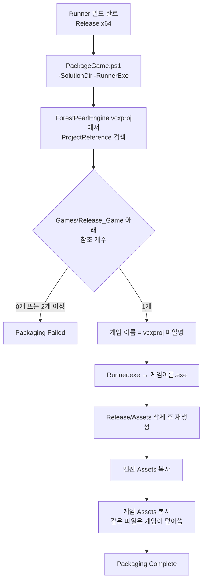

에셋 복사 규칙:

- `ShaderResource` 폴더를 제외한 모든 항목(`Shader/*.json` 포함)을 그대로 복사합니다.
- 셰이더는 `ShaderResource/bin/*`만 `Assets/ShaderResource/`로 복사합니다 (`bin` 폴더와 HLSL 소스는 포함되지 않음).

```text
x64/Release/
├── Tri_World.exe
└── Assets/
    ├── Font/
    ├── Level/
    ├── Model/
    ├── Shader/          *.json
    ├── ShaderResource/  *.vso, *.pso
    ├── StaticMesh/
    ├── Material/
    ├── Texture/
    └── TextureResource/
```

### 실행할 게임 바꾸기

1. 게임 프로젝트를 `Games/Release_Game/<이름>/`에 두고 솔루션에 추가합니다.
2. `ForestPearlEngine` 프로젝트의 **참조**를 해당 게임 프로젝트 하나로 교체합니다.
3. 게임의 `RegistProjectName()`에서 `FPPathManager::Get().Initialize("<이름>")`을 폴더 이름과 같게 지정합니다.
4. `Assets/GameSetting/GameSetting.json`을 반드시 추가하고 `RegistProjectName()`에서 `LoadGameSetting("GameSetting.json")`을 호출합니다 ([GameSetting](#gamesetting) 참고). 파일이 없으면 `FPGameProjectSetting::ProjectSetting()`이 `nullptr`인 `FPGameSettingData`를 참조해 죽습니다.

> `Runners/Runner/ReleaseGameProject.props`에는 `GameProjectName`, `GameAssetDir` 매크로가 정의되어 있으나, 현재 패키징은 이 파일이 아니라 엔진 프로젝트의 참조를 기준으로 동작합니다.

---

## 📝 콘텐츠 프로그래머 가이드

`Games/Release_Game/Tri_World`를 기준으로 게임을 만드는 순서입니다.

### 0. 프로젝트 만들기

- [Visual Studio 설정](#visual-studio-설정)의 ② 게임 프로젝트 속성, ③ 솔루션 연결을 따라 프로젝트를 만듭니다 ([프로젝트 템플릿](#프로젝트-템플릿) 사용 가능).
- 구성 형식 **정적 라이브러리**, C++17, 유니코드, 추가 포함 디렉터리 `$(SolutionDir)Engine`
- 엔진 헤더는 `#include "ForestPearlEngine/..."` 형태로 포함합니다.
- [실행할 게임 바꾸기](#실행할-게임-바꾸기) 절차로 엔진에 연결합니다.

### 1. GameProjectLoader.cpp — 엔진 Hook 구현

엔진이 부팅 중 호출하는 함수 5개를 구현합니다.

| 함수 | 호출 시점 | 할 일 |
|---|---|---|
| `RegistProjectName()` | 윈도우 생성 전 | 프로젝트 이름, `GameSetting.json` 로드(창 크기 · MSAA · AF · 전체화면) |
| `LoadLevel()` | 렌더러 초기화 후 | Level JSON 등록 |
| `LoadClassRegist()` | `LoadLevel` 다음 | 클래스 등록 |
| `LoadAssets()` | `LoadClassRegist` 다음 | FBX, StaticMesh, Shader 로드 |
| `ReturnStartLevel()` | `Initialize()` | 시작 레벨 이름 반환 |

```cpp
#include "ForestPearlEngine/GameProjectLoader.h"
#include "GameMode.h"
#include "GameController.h"
#include "Player.h"
// ...

void RegistProjectName()
{
    FPPathManager::Get().Initialize("Tri_World");          // 폴더 이름과 동일

    // Assets/GameSetting/GameSetting.json → FPGameSettingData로 로드
    // (창 크기 · MSAA · AF · 전체화면. ProjectSetting()은 엔진이 나중에 직접 호출)
    FPAssetLoader* AssetLoader = static_cast<FPAssetLoader*>(FPGameInstance::Get().GetAssetLoader());
    AssetLoader->LoadGameSetting("GameSetting.json");
}

void LoadLevel()
{
    FPAssetLoader* Loader = static_cast<FPAssetLoader*>(FPGameInstance::Get().GetAssetLoader());
    Loader->LoadLevelData("TriWorld", "TriWorld.json", AssetOwner::User);
}

void LoadClassRegist()
{
    FPGameProjectClassRegistry* Registry =
        static_cast<FPGameProjectClassRegistry*>(FPGameInstance::Get().GetClassRegister());

    Registry->Register<GameMode>("GameMode");
    Registry->Register<GameController>("GameController");
    Registry->Register<Player>("Player");
    // Level JSON · GameMode · StaticMesh JSON에서 이름으로 쓰는 모든 클래스
}

void LoadAssets()
{
    FPAssetLoader* Loader = static_cast<FPAssetLoader*>(FPGameInstance::Get().GetAssetLoader());

    Loader->LoadFbxData("Windmill/Windmill_Body.fbx", AssetOwner::User);               // ① FBX
    Loader->LoadStaticMesh("Windmill_Body_StaticMesh",
                           "Windmill_Body_StaticMesh.json", AssetOwner::User);         // ② StaticMesh
}

std::string ReturnStartLevel() { return "TriWorld"; }
```

#### 클래스 등록 규칙

> [!WARNING]
> **등록 이름은 반드시 등록하는 C++ 클래스 이름과 같아야 합니다** (대소문자 포함).
>
> ```cpp
> Registry->Register<Player>("Player");   // ✔ 클래스 이름 = 등록 이름
> Registry->Register<Player>("Hero");     // ✘ 이름이 다름
> Registry->Register<Windmill>("Player"); // ✘ 다른 클래스의 이름
> ```

레지스트리는 문자열과 타입이 일치하는지 검사하지 않습니다. 등록 이름은 데이터와 코드가 클래스를 가리키는 유일한 수단이며, 아래 모든 곳에서 **클래스 이름**으로 사용됩니다.

| 이름을 사용하는 곳 | 예 |
|---|---|
| Level JSON `gamemode` | `"gamemode": "GameMode"` |
| Level JSON `actors[].class` | `"class": "Tree"` |
| `FPAGameMode::ControllerList` | `ControllerList.push_back("GameController")` |
| StaticMesh JSON `Material` | `"Material": "CB2Material"` |
| `FPGameplayStatics` | `GetActorOfClass(GetWorld(), "Player")` → 결과를 `static_cast<Player*>`로 사용 |
| `FPWorld::SpawnActor` | `SpawnActor("Tree", "RuntimeTree")` |

| 잘못된 등록 | 결과 |
|---|---|
| 사용하는 이름이 등록되어 있지 않음 | Level 로드 · Controller 생성 · `SpawnActor`에서 `nullptr` 역참조로 종료. GameMode는 콘솔에 `…의 Class가 존재하지 않음`을 출력한 뒤 World 초기화에서 종료. `GetActorOfClass`는 `std::bad_typeid` 예외 |
| 다른 클래스의 이름으로 등록 | 엉뚱한 클래스가 생성되고, 이름을 믿고 `static_cast`한 코드가 잘못된 타입을 다룸 |
| 같은 이름으로 두 번 등록 | 경고 없이 나중 등록이 앞의 것을 덮어씀 |
| Material 이름이 등록되어 있지 않음 | 기본 `FPMaterial` 사용 (오류 없음) |

그 밖의 조건:

- 등록하는 클래스는 `FPObject`를 상속하고 **기본 생성자**가 있어야 합니다.
- Level JSON · GameMode · StaticMesh JSON · `FPGameplayStatics`에서 이름으로 쓰는 클래스는 **모두** 등록해야 합니다.

### 2. GameMode — 사용할 Controller 지정

```cpp
class GameMode : public FPAGameMode { /* Initialize / BeginPlay / Tick override */ };

void GameMode::Initialize()
{
    ControllerList.push_back("GameController");   // 0번 = Player Controller
    __super::Initialize();                        // 여기서 Controller가 생성됨
}
```

### 3. Controller — 키 매핑과 전역 입력

```cpp
void GameController::Initialize()
{
    // ① 매핑: Input Action 이름, 키, Modifier
    GetInputComponent().AddMappingKey("IA_SetMoveTriangel", 'W', { ESwizzle::YZX, ENegative::Positive });
    GetInputComponent().AddMappingKey("IA_SetMoveTriangel", 'S', { ESwizzle::YZX, ENegative::Negative });
    GetInputComponent().AddMappingKey("IA_SetMoveTriangel", 'A', { ESwizzle::XYZ, ENegative::Negative });
    GetInputComponent().AddMappingKey("IA_SetMoveTriangel", 'D', { ESwizzle::XYZ, ENegative::Positive });
    GetInputComponent().AddMappingKey("IA_SetMoveTriangel",
        static_cast<USHORT>(XBOX_GAMEPAD::GAMEPAD_LSTICK), { ESwizzle::XYZ, ENegative::Positive });

    // ② 바인딩: Controller 자신에게 바인딩한 함수는 Possess 대상과 무관하게 호출됨
    GetInputComponent().BindMethod("IA_NextActor", this, EKeyState::Down, &GameController::NextPawn);

    __super::Initialize();
}

void GameController::NextPawn(FInputValue Value)
{
    ControllPawnIndex = (ControllPawnIndex + 1) % ControllPawnSize;
    Possess(ControllPawn[ControllPawnIndex]);
}
```

### 4. Actor / Pawn — 컴포넌트 조립

| 베이스 | 용도 | Tri_World 예 |
|---|---|---|
| `FPActor` | 배치만 하는 오브젝트 | `Terrain`, `Tree`, `Grid`, `Axis`, `UI` |
| `FPPawn` | Possess 대상 | `Player`, `Windmill`, `WindmillWing`, `TripleWindmillWing`, `TripleWingWindmill` |

```cpp
void Player::Initialize()
{
    // 메시를 Root로
    Mesh = new FPStaticMeshComponent(this, "ToonLinkTriangle_StaticMesh");
    SetRootComponent(Mesh);

    // 자식 컴포넌트
    ShieldPivot = new FPSceneComponent(this);
    ShieldPivot->SetupAttachment(Mesh);
    ShieldPivot->SetRelativeLocation({ 0.0f, 2.0f, 0.0f });

    // 3인칭 카메라
    SpringArm = new FPSpringArmComponent(this);
    SpringArm->SetupAttachment(RootComponent);
    SpringArm->TargetArmLength = 50.0f;
    SpringArm->SetRelativeRotation({ 30.0f, 0.0f, 0.0f });
    SpringArm->bUsePawnControlRotation = true;

    PlayerCamera = new FPCameraComponent(this);
    PlayerCamera->SetupAttachment(SpringArm);

    // 입력 바인딩 + Possess
    FPAController* Controller = GetWorld()->GetController(0);
    Controller->GetInputComponent().BindMethod("IA_SetMoveTriangel", this, EKeyState::Pressed, &Player::Move);
    Controller->Possess(this);
}

void Player::Move(FInputValue Value)
{
    float Delta = GetWorld()->GetGameTimer()->DeltaTime();
    RootComponent->AddWorldOffset({ Value.X * 10.0f * Delta, 0.0f, Value.Y * 10.0f * Delta });
}

void Player::Tick()
{
    // ... 로직
    __super::Tick();   // 필수: 컴포넌트 트랜스폼 갱신
}
```

**생명주기**

| 함수 | 시점 | 권장 작업 |
|---|---|---|
| `Initialize()` | 레벨의 모든 액터가 생성된 뒤 | 컴포넌트 생성, 입력 바인딩 |
| `BeginPlay()` | 모든 액터의 `Initialize()` 이후 | 다른 액터 검색, Attach |
| `Tick()` | 매 프레임 | 로직 후 `__super::Tick()` |

> [!CAUTION]
> 소멸 처리는 아직 구성되지 않았습니다. 액터와 컴포넌트를 런타임에 `delete`하지 말고 `SetActive(false)`로 숨기세요.
> 자세한 내용은 [알려진 문제 — 소멸 처리](#-알려진-문제--소멸-처리)를 참고하세요.

### 5. 컴포넌트 레퍼런스

#### `FPSceneComponent` — 트랜스폼 계층

| 분류 | 함수 |
|---|---|
| 부착 | `SetupAttachment(Parent, SocketName = "")`, `DetachFromComponent()`, `GetAttachmentRoot()` |
| 설정 (부모 기준) | `SetRelativeLocation`, `SetRelativeRotation`, `SetRelativeScale3D` |
| 설정 (월드 기준) | `SetWorldLocation`, `SetWorldRotation`, `SetWorldScale3D` |
| 증분 | `AddLocalOffset`, `AddLocalRotation`(자신의 축 기준 회전), `AddRelativeLocation`, `AddRelativeRotation`(부모 축 기준 회전), `AddWorldOffset`, `AddWorldRotation` |
| 조회 | `GetComponentTransform / Location / Rotation / Quat / Scale`, `GetRelativeTransform / Location / Rotation / Scale3D`, `GetSocketTransform(name)` |

월드 변환은 `Scale = 부모 × 로컬`, `Rotation = 부모 사원수 × 로컬 사원수`, `Location = 부모 위치 + Rotate(부모 회전, 로컬 위치 × 부모 스케일)`로 계산합니다. Socket에 붙은 경우 부모 대신 Socket의 월드 Transform을 사용합니다.

#### `FPStaticMeshComponent` — 메시 렌더링

```cpp
auto* Body = new FPStaticMeshComponent(this, "Windmill_Body_StaticMesh");  // LoadStaticMesh 이름
```

| 함수 | 설명 |
|---|---|
| `SetActive(bool)` | 렌더링 On/Off. `false`면 Render List 생성 단계에서 제외됨 |
| `SetPriority(int)` | 값이 **작은** 항목부터 그려짐 |
| `SetMaterial(FPMaterialInterface*)` | Material 교체 ([상수 버퍼 운용 시 유의사항](#8-커스텀-material과-상수-버퍼)) |
| `SetStaticMesh(name)` | 메시 교체. 현재는 이전 메시의 렌더 항목이 남아 함께 그려짐 ([알려진 문제](#-알려진-문제--소멸-처리)) |
| `GetSocketTransform(name)` | Socket의 월드 Transform |

> Fill(Solid / Wireframe) · Cull(뒷면 제거)은 컴포넌트별이 아니라 렌더러 전역 설정입니다.
> `ForestPearlEngine::GetGameEngine().SetbFill(bool)` / `SetbCull(bool)`로 바꾸며, `MeshRenderPass`와 `GizmoRenderPass`에 모두 적용됩니다.

#### `FPCameraComponent` — 카메라

| 멤버 | 기본값 | 설명 |
|---|---|---|
| `Fov` | 45° | 시야각 |
| `Aspect` | 960 / 600 | 화면비 |
| `Zn` / `Zf` | 1 / 100 | 근/원 평면 |
| `Active` | `true` | 사용 여부 |
| `OnTripleCam()` | — | 3분할 뷰포트 토글 |

컴포넌트의 월드 위치·회전으로 View 행렬을 만들기 때문에, SpringArm이나 다른 컴포넌트에 붙이는 것만으로 카메라가 움직입니다.

#### `FPSpringArmComponent` — 스프링 암

| 멤버 | 설명 |
|---|---|
| `TargetArmLength` | 자식(카메라)이 놓이는 거리. 암의 전방(+Z) 반대 방향 |
| `bUsePawnControlRotation` | `true`면 부모 회전 대신 **Controller의 회전**을 사용 |

Pawn에서 `AddControllerYawInput(v)`, `AddControllerPitchInput(v)`를 호출하면 카메라가 회전합니다.

#### `FPGizmoGridComponent` · `FPGizmoAxisComponent` — Grid / Axis

```cpp
// Grid::Initialize()
GridComponent = new FPGizmoGridComponent(this, "Grid");        // 두 번째 인자 = 기즈모 메시 이름 (VertexBuffer 키, 기즈모마다 고유하게)
SetRootComponent((FPSceneComponent*)GridComponent);

// Axis::Initialize()
AxisComponent = new FPGizmoAxisComponent(this, "Axis");        // X 빨강 / Y 초록 / Z 파랑
SetRootComponent((FPSceneComponent*)AxisComponent);
```

생성자가 기본값(`GIZMO_GRIDINFO` / `GIZMO_AXISINFO`)으로 라인 메시를 만들어 `FPGizmoRenderList`에 등록합니다.
기즈모는 `GizmoRenderPass`에서 `LINELIST`로 그려지며, 메시와 같은 Material · 상수 버퍼 규칙을 따릅니다. `SetActive`, `SetPriority`를 제공합니다.

#### `FPTextComponent` — 화면 텍스트

```cpp
FPTextComponent* Text = new FPTextComponent();
Text->SetTextData(&bShow, 10, 10, { 1.0f, 1.0f, 0.0f, 1.0f }, _T("Hello"));
//                 ↑ 표시 여부 bool의 주소 (여러 텍스트가 하나의 플래그를 공유 가능)
```

좌표는 클라이언트 영역 픽셀, 색은 RGBA(0~1)입니다. 내용이 바뀌면 `SetTextData`를 다시 호출합니다.

#### `FPInputComponent` — 입력

Controller가 소유합니다. `GetWorld()->GetController(0)->GetInputComponent()`로 접근하며 `AddMappingKey`, `BindMethod`를 제공합니다 ([Input 시스템](#-input-시스템) 참고).

#### `FPMovementComponent`

`UpdatedComponent`를 가지는 골격만 정의되어 있습니다.

### 6. Socket과 Attach

```cpp
// 액터를 다른 액터의 Root 메시 Socket에 부착
AttachToActor(Body, "WingPoint1");

// 액터를 특정 컴포넌트에 부착
AttachToComponent(ShieldPivot);

// 컴포넌트를 Socket에 부착
Wing1->SetupAttachment(Body, "UpScaleWingPoint1");

// 분리
DetachFromActor();
```

- Socket은 StaticMesh JSON의 `Sockets`에 정의합니다.
- Socket 이름이 없거나 찾을 수 없으면 부모 컴포넌트의 Transform에 붙습니다.
- Attach 후 `SetRelative*`로 Socket 기준 오프셋을 조정합니다.

### 7. 유틸리티

```cpp
// 액터 검색 (ClassRegistry에 등록한 이름)
FPActor* P = FPGameplayStatics::GetActorOfClass(GetWorld(), "Player");

std::vector<FPActor*> Windmills;
FPGameplayStatics::GetAllActorsOfClass(GetWorld(), "Windmill", Windmills);

// 시간
float Delta = GetWorld()->GetGameTimer()->DeltaTime();

// 런타임 스폰 (Initialize → BeginPlay 즉시 호출)
FPActor* NewTree = GetWorld()->SpawnActor("Tree", "RuntimeTree");

// 엔진 기능
ForestPearlEngine::GetGameEngine().SetZEnable(false);              // 깊이 테스트
ForestPearlEngine::GetGameEngine().GetAdapterDescription(0);       // GPU 이름
ForestPearlEngine::GetGameEngine().StopEngine();                   // 종료
```

### 8. 커스텀 Material과 상수 버퍼

셰이더에 게임 데이터(색, 시간, 비율 등)를 넘기려면 `FPMaterial`을 상속해 **상수 버퍼를 등록**합니다.
슬롯 번호와 레지스터의 대응은 [상수 버퍼 슬롯 규약](#슬롯-규약)을 따릅니다.

> [!WARNING]
> 현재 `MeshRenderPass`는 Material이 등록한 상수 버퍼를 셰이더로 보내지 않습니다 (Light · Material 색으로 자체 구성). 아래 방식은 **`GizmoRenderPass`로 그려지는 항목**에서만 동작합니다. 메시에 커스텀 상수 버퍼를 쓰려면 `CreateMeshRenderList`에서 `RenderItemData.VertexConstBuffer` / `PixelConstBuffer`를 복사해 이어 붙이도록 엔진을 수정해야 합니다.

#### 작성 순서

```cpp
#include "ForestPearlEngine/FPMaterial.h"
#include <cmath>

class PulseMaterial : public FPMaterial
{
    // ① 상수 버퍼용 구조체: 16 byte 배수, 멤버 순서 = HLSL cbuffer 선언 순서
    struct alignas(16) VSParams { float Scale; float Pad[3]; };         // 16 byte  → VS 등록 슬롯 0 = b2
    struct alignas(16) PSParams { float R, G, B, A; };                  // 16 byte  → PS 등록 슬롯 0 = b1

    VSParams VSData{ 1.0f, {} };
    PSParams PSData{ 1.0f, 1.0f, 0.0f, 1.0f };
    float    Time = 0.0f;

public:
    PulseMaterial()
    {
        // ② 생성자에서 등록. 등록 순서가 곧 인덱스이므로 0번부터 빈틈없이
        FPConstantBufferRenderDataUtil::AddConstantBuffer(VertexConstantBuffer, 0, VSData);
        FPConstantBufferRenderDataUtil::AddConstantBuffer(PixelConstantBuffer,  0, PSData);
    }

    void UpdateMaterial(float DeltaTime) override
    {
        Time += DeltaTime;
        VSData.Scale = 1.0f + 0.2f * sinf(Time);
        PSData.G     = 0.5f + 0.5f * sinf(Time);

        // ③ 멤버만 바꿔서는 반영되지 않음. 바뀐 값을 다시 복사해 넣어야 함
        FPConstantBufferRenderDataUtil::UpdateConstantBuffer(VertexConstantBuffer, 0, VSData);
        FPConstantBufferRenderDataUtil::UpdateConstantBuffer(PixelConstantBuffer,  0, PSData);
    }
};
```

```hlsl
// Pulse.vsh — Object(b0)는 기본 셰이더와 같은 순서로 선언
cbuffer ObejctConstBuffer : register(b0) { matrix mWorld; matrix mView; matrix mProj; matrix mWV; matrix mWVP; };
cbuffer PulseVS           : register(b2) { float gScale; float3 _pad; };   // VS Material 슬롯 0

// Pulse.psh
cbuffer PulsePS           : register(b1) { float4 gColor; };               // PS Material 슬롯 0
```

```cpp
// 사용: 셰이더는 LoadAssets()에서 미리 로드해 둔다
PulseMat = new PulseMaterial();
PulseMat->SetVertexShader("Pulse.vso");
PulseMat->SetPixelShader("Pulse.pso");
Mesh->SetMaterial(PulseMat);               // 메시 컴포넌트를 만든 직후에 호출 ([알려진 문제] 참고)

void MyActor::Tick()
{
    PulseMat->UpdateMaterial(GetWorld()->GetGameTimer()->DeltaTime());   // 엔진이 자동 호출하지 않음
    __super::Tick();
}
```

StaticMesh JSON의 `"Material"`로 지정하려면 `Registry->Register<PulseMaterial>("PulseMaterial")`로 등록합니다 ([클래스 등록 규칙](#클래스-등록-규칙)).

#### ⚠️ 상수 버퍼 운용 시 유의사항

> [!IMPORTANT]
> 상수 버퍼는 **컴파일러와 런타임이 거의 검사해 주지 않는 영역**입니다. 규칙을 어기면 오류 메시지 없이 색이 이상하거나, 다른 Material 값이 섞이거나, 메모리가 손상됩니다.

**① 크기 · 레이아웃**

| 규칙 | 이유 / 어기면 |
|---|---|
| **구조체 1개의 크기는 320 byte 이하** | 슬롯의 GPU 버퍼가 320 byte 고정입니다. 크기 검사가 없어 더 큰 구조체는 `Map`된 메모리를 넘어 `memcpy`합니다 (메모리 손상). 큰 데이터는 구조체를 나눠 슬롯 여러 개로 등록하세요 |
| **구조체에 `alignas(16)`을 붙이고 크기를 16 byte 배수로** | HLSL `cbuffer`는 16 byte 단위로 패킹됩니다. 모자라는 부분은 `float Pad[n]`으로 명시해 두면 C++ · HLSL 레이아웃을 맞추기 쉽습니다 |
| **멤버 순서 · 타입을 HLSL `cbuffer`와 완전히 일치** | 컴파일러가 둘을 대조하지 않습니다. 순서가 다르면 값이 엉뚱한 변수로 들어갑니다 |
| **하나의 `float4`(16 byte) 경계를 넘는 멤버를 두지 않는다** | `float3` 뒤에는 `float`이 같은 16 byte 안으로 들어가고, `float2` 다음 `float3`은 다음 16 byte로 넘어갑니다. 헷갈리면 모두 `float4` 단위로 설계하세요 |
| **`bool`을 쓰지 않는다. `float` / `int` / `uint`를 사용** | C++ `bool`은 1 byte, HLSL `bool`은 4 byte입니다 |
| **배열은 요소마다 16 byte** | HLSL `float arr[4]`는 16 × 4 = 64 byte로 패킹됩니다. 배열이 필요하면 `float4` 배열로 선언하세요 |
| **`std::string` · `std::vector` · 포인터 · 가상 함수가 있는 타입은 담지 않는다** | `memcpy`로 복사되므로 `std::is_trivially_copyable`이어야 합니다. 어기면 컴파일 단계에서 `static_assert`로 막히거나, 포인터를 넣으면 주소값이 GPU로 갑니다 |

**② 슬롯 · 등록**

| 규칙 | 이유 / 어기면 |
|---|---|
| **Material 슬롯 `k`는 VS `b(2+k)`, PS `b(1+k)`** | `register(b#)`를 이 표대로 선언해야 합니다. VS의 `b0`(Object), `b1`(ViewPort)은 엔진 예약이라 **Material이 쓸 수 없습니다.** PS `b0`도 ViewPort 예약입니다 |
| **슬롯은 VS 최대 `k = 11`, PS 최대 `k = 12`** | 상수 버퍼는 `b13`까지입니다. 범위를 검사하지 않아 넘어가면 배열 범위 밖 접근으로 종료됩니다 |
| **`AddConstantBuffer`는 0번부터 순서대로, 빈틈 · 중복 없이** | `UpdateConstantBuffer`의 두 번째 인자는 셰이더 슬롯이 아니라 **등록 순서 인덱스**입니다. 번호를 건너뛰거나 순서가 달라지면 엉뚱한 항목을 덮어씁니다 |
| **VS와 PS는 각각 등록한다** | VS `b2`와 PS `b2`는 서로 다른 버퍼입니다. 같은 값을 양쪽에서 쓰려면 `VertexConstantBuffer`와 `PixelConstantBuffer`에 따로 등록하세요 |
| **셰이더가 선언한 `cbuffer` 수 = Material이 등록한 수** | 28개 버퍼는 **모든 오브젝트가 돌려 씁니다.** Material이 등록하지 않은 슬롯을 셰이더가 읽으면 *직전에 그려진 다른 Material의 값*(처음에는 0 / 쓰레기)이 보입니다 |
| **기본 셰이더(`Default*.vso/.pso`)를 쓰면 등록하지 않는다** | 기본 셰이더는 `b0`만 사용합니다 |
| **뷰포트 상수 버퍼(`b1`)를 다른 용도로 선언하지 않는다** | VS `b1`에는 매 뷰포트마다 엔진이 `VertexConst { AniOn, BlendOn }`을 씁니다 |

**③ 값 갱신**

| 규칙 | 이유 / 어기면 |
|---|---|
| **구조체를 바꾼 뒤 `UpdateConstantBuffer`를 호출** | `Add` / `Update`는 호출 시점의 값을 **복사**합니다. 구조체 멤버만 수정하면 셰이더는 등록 당시의 값을 계속 봅니다 |
| **`Update`에는 `Add`와 같은 타입을 넘긴다** | 크기 일치 검사(`assert`)는 **Debug에서만** 동작합니다. Release에서는 다른 크기를 조용히 복사합니다 |
| **구조체는 값(또는 참조)으로 넘기고, 포인터를 넘기지 않는다** | `Add(…, 0, ptr)`처럼 포인터를 넘기면 `T`가 포인터 타입으로 추론되어 **포인터 값 8 byte가 복사**됩니다 (오류 없이 컴파일됨). 항상 `Add(…, 0, *ptr)` 또는 값 변수를 넘기세요 |
| **`UpdateMaterial()`을 `Tick()`에서 직접 호출** | 엔진은 호출하지 않습니다. Render List는 `Tick`이 끝난 뒤 복사되므로 `Tick` 안에서 갱신하면 같은 프레임에 반영됩니다 |
| **값이 바뀌지 않으면 `Update`를 생략한다** | 등록해 둔 값은 유지됩니다. `Update`는 `memcpy`만 하지만, 상수 버퍼 데이터는 프레임마다 Render List로 통째로 복사되고 GPU 쓰기(`Map`)는 *오브젝트 × 카메라*마다 일어나므로 작게 유지하는 편이 좋습니다 |

**④ 소유 · 수명**

| 규칙 | 이유 / 어기면 |
|---|---|
| **상수 버퍼 데이터는 Material 인스턴스가 소유한다** | 같은 Material 포인터를 공유하는 메시는 값도 공유합니다. 메시마다 다른 값이 필요하면 Material을 `new`로 각각 만드세요 |
| **Material을 `delete`하지 않는다** | 렌더 항목이 Material의 상수 버퍼 데이터 **주소**를 들고 있어 Dangling이 됩니다 ([알려진 문제](#-알려진-문제--소멸-처리)) |
| **`SetMaterial()`은 메시 컴포넌트를 만든 직후에 호출** | 렌더 항목 포인터가 무효화될 수 있습니다 ([사용 규칙](#4-현재-버전에서-지켜야-할-사용-규칙)) |
| **`b0`의 행렬은 `mul(mWVP, pos)` 순서로 사용** | CPU 행렬이 전치 없이 전달됩니다. 직접 행렬을 상수 버퍼로 넘길 때도 같은 규칙을 따르세요 |

**⑤ 체크리스트**

- [ ] 구조체가 `alignas(16)`이고 `sizeof`가 16의 배수이며 320 이하인가?
- [ ] 멤버 순서 · 타입이 HLSL `cbuffer`와 같은가? (`bool`, 배열, `float3` 패킹 확인)
- [ ] `AddConstantBuffer`를 0번부터 빈틈없이 등록했고, `register(b#)`가 VS `b(2+k)` / PS `b(1+k)`와 맞는가?
- [ ] 셰이더가 선언한 `cbuffer`를 전부 Material이 등록했는가?
- [ ] 값을 바꾼 뒤 `UpdateConstantBuffer`를 호출하고, 그 호출이 `Tick()`에서 일어나는가?
- [ ] 포인터가 아니라 구조체를 `Add` / `Update`에 넘겼는가?
- [ ] 메시마다 값이 달라야 한다면 Material 인스턴스를 따로 만들었는가?

> [!NOTE]
> `Games/Release_Game/ShaderCode_Triangle`의 `CB2Material` 등 기존 샘플은 이전 방식(`VertextConst = 포인터`)과 이전 슬롯 규약(PS `b0`)을 사용하므로 **현재 엔진에서 그대로 빌드 · 동작하지 않습니다.** 위 방식으로 옮겨서 사용하세요.

### 9. Texture 사용

텍스처는 **에셋으로 로드**한 뒤, 메시의 **Material 슬롯에 이름으로 지정**합니다. 내부 흐름은 [Texture](#texture)를 참고하세요.

```cpp
// ① 에셋 준비: Assets/Texture/Brick.json → Assets/TextureResource/brick.dds
//    { "TextureData": [ { "Path": "brick.dds", "Type": "DDS" } ] }

// ② LoadAssets()에서 로드 (이름 "Brick"이 이후 지정에 쓰는 키)
Loader->LoadTexture("Brick", "Brick.json", AssetOwner::User);

// ③ Actor::Initialize() 또는 BeginPlay()에서 지정
Mesh = new FPStaticMeshComponent(this, "Plane_StaticMesh");     // 엔진 기본 Plane 메시

FPMaterialInterface& Material = Mesh->GetMaterial();
std::string TextureName = "Brick";                               // 변수로 전달 (아래 표 참고)
Material.SetTexture(0, TextureName);                             // 슬롯 0의 텍스처 교체
Material.SetTexture(0, TextureName, Filter_Tri_Linear_Sampler_Wrap);  // 샘플러까지 지정 (필터_주소모드)

Material.AddTexture(1);                                          // 슬롯 추가 (PS t1)
std::string Detail = "Checker_dds";
Material.SetTexture(1, Detail);
```

| 함수 (`FPMaterialInterface`) | 설명 |
|---|---|
| `SetTexture(Slot, Name)` | 슬롯의 텍스처 이름을 바꿈 |
| `SetTexture(Slot, Name, SamplerType)` | 텍스처와 샘플러를 함께 바꿈 |
| `SetTextureSampler(Slot, SamplerType)` | 샘플러만 바꿈 |
| `AddTexture(Slot)` | 슬롯 추가. 기본값은 `Default_Texture512` + `Filter_Tri_Linear_Sampler_CLAMP` |
| `DeleteTexture(Slot)` | 슬롯 제거 |

엔진이 기본 제공하는 에셋: 메시 `Plane_StaticMesh`(`Primitive_Model/Plane.fbx`), 텍스처 `Default_Texture512` · `Checker_bmp` · `Checker_dds`. 샘플은 `Games/Release_Game/Lambert_Light/Plane.cpp`입니다.

#### 여러 텍스처를 쓰는 셰이더

```hlsl
Texture2D    TexDiff   : register(t0);   // 슬롯 0
Texture2D    TexDetail : register(t1);   // 슬롯 1 (AddTexture(1))
SamplerState Smpler    : register(s0);   // 사용하는 샘플러 종류 중 가장 앞선 것
```

#### ⚠️ 유의사항

| 항목 | 이유 / 어기면 |
|---|---|
| **`SetTexture`에는 문자열 리터럴이 아니라 `std::string` 변수를 넘긴다** | 인자가 `std::string&`(비 const 참조)라서 `SetTexture(0, "Brick")`은 컴파일되지 않습니다 |
| **`AddTexture(Slot)`로 만든 슬롯에만 `SetTexture`가 동작한다** | 없는 슬롯에 호출하면 **아무 일도 일어나지 않고 메시지도 없습니다.** 슬롯 0만 자동으로 존재합니다 |
| **슬롯은 `0 ~ 127`** | 128 이상은 메시지를 출력하고 무시됩니다 |
| **텍스처 이름은 `LoadTexture`의 첫 인자와 같아야 한다** | 로드하지 않은 이름을 지정하면 빈 항목이 만들어져 `nullptr` 리소스가 바인딩되고, 기본 PS에서는 메시가 검게 보입니다. `LoadAssets()`에서 먼저 로드하세요 |
| **`GetMaterial()`은 컴포넌트가 가진 Material을 반환한다** | StaticMesh JSON의 `Material.Name`이 [Material JSON](#material-json)으로 `MakeMaterial`을 거쳐 자동으로 채워지므로(없으면 `DefaultMaterial`) 보통 널 참조가 나지 않습니다. 코드로 직접 교체하려면 컴포넌트 생성 **직후** `SetMaterial()`을 호출하세요 |
| **텍스처는 Material 단위다** | 같은 Material 객체를 여러 메시에 `SetMaterial`하면 텍스처도 함께 바뀝니다. 기본 Material은 컴포넌트마다 따로 만들어지므로 `GetMaterial()`로 바꿔도 해당 메시에만 적용됩니다 |
| **셰이더의 `t#`는 Material 슬롯과 같다** | 슬롯 `n` → `t(n)`. 셰이더가 읽는 슬롯은 모두 `AddTexture`로 만들어 두세요. Pass는 텍스처를 **해제하지 않으므로**, 슬롯이 없는 메시를 그리면 직전 메시의 텍스처가 남아 보일 수 있습니다 |
| **샘플러 `s#`는 슬롯이 아니라 종류 순서다** | 한 메시에서 샘플러를 하나만 쓰면 `s0`입니다. 둘 이상 섞을 때는 [바인딩 규칙](#바인딩-규칙)의 순서를 따르세요 |
| **샘플러는 엔진이 부팅 때 만든 36종(필터 4 × 주소모드 9)만 쓸 수 있다** | `CreateSamplers()`는 `PreInitialize()`에서 렌더러 초기화 직후 호출됩니다. Anisotropic 샘플러의 단계는 `GameSetting.json`의 `AnisotropicFiltering`으로 정해지며, 게임 코드에서 따로 호출할 필요는 없습니다 ([Texture](#texture) 참고) |
| **메시(`MeshRenderPass`)에서만 동작한다** | Gizmo · Normal · UI Pass는 텍스처를 바인딩하지 않습니다 |
| **큰 텍스처는 DDS(밉맵 포함)로 변환해 쓴다** | `Tool/DXTexViewer/DxTex.exe`로 변환할 수 있습니다. 슬롯 수만큼 SRV 바인딩이 *메시 × 카메라*마다 일어나므로 쓰지 않는 슬롯은 `DeleteTexture`로 지우세요 |

---

## 🎬 Demo 프로젝트 — Tri_World

> 위치: [`Games/Release_Game/Tri_World`](Games/Release_Game/Tri_World)

SpringArm 카메라, Possess 전환, Socket 부착, 계층 트랜스폼을 한 장면에서 확인하는 데모입니다.

### 실행

| 방법 | 절차 |
|---|---|
| 패키지 실행 | `Release\|x64` 빌드 → `x64/Release/Tri_World.exe` |
| 디버그 실행 | `Debug\|x64`, 시작 프로젝트 **Runner** → F5 |

> [!NOTE]
> `GameProjectLoader.cpp`의 `ReturnStartLevel()`은 다시 **`"TriWorld"`**를 반환합니다 (`//return "ToonLink";`은 주석 처리). ToonLink 캐릭터 단독 데모(`Assets/Level/ToonLink.json` — `Terrain` · `Axis` · `Grid` · `UI` · `ADirectionalLight` + `Link`)를 보려면 두 줄의 주석을 바꾸면 됩니다. `Player`는 `BodyAndHat` · `Hair` · `Face` · `Eye` · `EyeBrow` · `Mouth` · `Hand` · `Buckle` · `MasterSword_*`(4개) · `Shield_*`(2개) 등 StaticMeshComponent 15개로 구성되며, 각 서브메시는 [FBX 변환 도구](#fbx-변환-도구-fbxtostaticmeshjsontranslator)가 만든 StaticMesh + Material Instance + Texture JSON을 사용합니다 ([Material JSON](#material-json), [Alpha Blend](#alpha-blend-초기-구현) 참고).

### 씬 구성 (`Assets/Level/TriWorld.json`, 액터 311개)

| 클래스 | 수 | 베이스 | 구성 | 설명 |
|---|:-:|---|---|---|
| `Terrain` | 1 | `FPActor` | StaticMesh | 128×128 지형. `Terrain_Material`(Two Sided, `Field_micro02_dds` Wrap, 전용 `TerrainVertexShader`로 UV ×20 타일링) |
| `Tree` | 300 | `FPActor` | StaticMesh × 2 (잎 · 줄기) | 나무. `Tree_Material`(Two Sided, `Tree01s_dds`, `TreePixelShader`) |
| `Grid` | 1 | `FPActor` | Gizmo | 128×128 그리드 |
| `Axis` | 1 | `FPActor` | Gizmo | 월드 축 |
| `ADirectionalLight` | 1 | `FPActor` | DirectionalLight | 씬 전체를 비추는 Directional Light. Direction `(0.43, -0.64, 0.64)` |
| `UI` | 1 | `FPActor` | Text × 19 | FPS, 도움말, GPU / 해상도 / 렌더 상태 |
| `Player` | 1 | `FPPawn` | StaticMesh + ShieldPivot + SpringArm + Camera | 시작 시 Possess. 제자리에서 계속 회전 |
| `Windmill` | 2 | `FPPawn` | StaticMesh (몸체) | 이동 / 회전 / 크기 조절. `WindmillBody_Material`(`Windmill_jpg` t0 + `Windmill_a_jpg` t1, `WindmillWingBody_PixelShader`) |
| `WindmillWing` | 1 | `FPPawn` | StaticMesh (날개) | `Windmill`의 `WingPoint1` Socket에 부착. Player에게 옮겨 붙일 수 있음. `WindmillWing_Material`(Two Sided) |
| `TripleWindmillWing` | 1 | `FPPawn` | StaticMesh × 3 | 날개 → 날개 → 날개로 이어지는 3단 Socket 체인. `Windmill2`의 `TripleWingPoint`에 부착 |
| `TripleWingWindmill` | 1 | `FPPawn` | StaticMesh × 4 | 몸체 + `UpScaleWingPoint1~3` Socket에 크기·속도가 다른 날개 3개 |

### Tri_World의 텍스처 · Material

색을 코드(`SetBaseColor`)로 지정하던 Terrain · Tree · Windmill 액터가 **Material JSON + 텍스처**로 바뀌었습니다. 액터 코드에서 `GetMaterial().SetBaseColor(...)` 호출이 제거되었고, 색은 Material의 `BaseColor`(기본 흰색)와 텍스처가 정합니다.

| Material | 셰이더 | 텍스처 (슬롯 / 샘플러) | Two Sided |
|---|---|---|:-:|
| `Terrain_Material` | `TerrainVertexShader` + `TerrainPixelShader` | `Field_micro02_dds` (0 / `Sampler_Wrap`) | ✔ |
| `Tree_Material` | `DefaultVertexShader` + `TreePixelShader` | `Tree01s_dds` (0 / `Sampler_CLAMP`) | ✔ |
| `WindmillBody_Material` | `DefaultVertexShader` + `WindmillWingBody_PixelShader` | `Windmill_jpg` (0), `Windmill_a_jpg` (1) / `Sampler_CLAMP` | — |
| `WindmillWing_Material` | `DefaultVertexShader` + `WindmillWingBody_PixelShader` | `Windmill_jpg` (0), `Windmill_a_jpg` (1) / `Sampler_CLAMP` | ✔ |

- **Terrain** — 전용 VS가 `uv`에 20을 곱해 하나의 텍스처를 지형 전체에 반복합니다. 반복하려면 샘플러가 `Sampler_Wrap`이어야 합니다 (Material JSON에서 지정).
- **Windmill** — PS가 `t0`(색)과 `t1`(알파 마스크)을 모두 샘플링해 `col * tex * tex2`를 출력하고, 알파를 `t1`에서 가져와 [Alpha Blend](#alpha-blend-초기-구현)로 투명 영역을 처리합니다.
- **Tree** — 잎과 줄기가 서로 다른 StaticMesh(`Tree_StaticMesh`, `Tree_Trunk_StaticMesh`)이며 같은 텍스처를 사용합니다.
- 이 셰이더들은 `Assets/Shader/*.json`으로 등록하고 `LoadAssets()`에서 `LoadVertexShader` / `LoadPixelShader`로 로드합니다 ([셰이더 JSON](#셰이더-json)). `LoadAssets()`의 등록 순서는 **셰이더 → 텍스처 → Material → StaticMesh**입니다.
- 에셋은 모델별 폴더(`Terrain/` · `Tree/` · `Windmill/` · `ToonLink/`)로 정리되었고, 로더 호출도 `"Terrain/Terrain_Material.json"`처럼 하위 폴더 경로를 포함합니다.
- `Windmill_Body.fbx` / `Windmill_Wing.fbx`는 `Windmill.fbx` 하나로 합쳐졌고 StaticMesh JSON의 `NodeName`(`Windmill_Body` · `Windmill_Wing`)으로 각각 찾습니다.
- `Player`의 SpringArm 길이는 `50`으로 복원되었습니다.
- 모든 텍스처는 필터가 `Filter_Tri_Linear`(기본값)이고 주소 모드만 위 표의 값을 씁니다. 그래픽 옵션은 `Assets/GameSetting/GameSetting.json`에서 `MSAA: 8`, `AnisotropicFiltering: 16`, `Resolution: 960×600`으로 설정되어 있습니다 ([GameSetting](#gamesetting) 참고).

**Socket 정의**

| StaticMesh | Socket |
|---|---|
| `Windmill_Body_StaticMesh` | `WingPoint1`, `UpScaleWingPoint1`, `UpScaleWingPoint2`, `UpScaleWingPoint3`, `TripleWingPoint` |
| `Windmill_Wing_StaticMesh` | `WingPoint1` |
| `ToonLink_StaticMesh`, `ToonLinkTriangle_StaticMesh` | `ShieldPivot`, `HeadPivot` |

### 조작법

조작 대상은 **현재 Possess 중인 Pawn**입니다. Possess 순서는 `Player → Windmill → Windmill2 → TripleWingWindmill`이며 시작 대상은 `Player`입니다.

#### ⌨️ 키보드 · 마우스

| 키 | 동작 | 대상 |
|:-:|---|---|
| <kbd>W</kbd> <kbd>A</kbd> <kbd>S</kbd> <kbd>D</kbd> | 이동 (전 / 좌 / 후 / 우) | Possess 중인 Pawn |
| <kbd>I</kbd> <kbd>K</kbd> | 카메라 Pitch 회전 | Player |
| <kbd>J</kbd> <kbd>L</kbd> | 카메라 Yaw 회전 | Player |
| <kbd>Q</kbd> <kbd>E</kbd> | Y축 회전 (+ / −) | Windmill, TripleWingWindmill |
| <kbd>R</kbd> <kbd>F</kbd> | 크기 확대 / 축소 | Windmill, TripleWingWindmill |
| <kbd>.</kbd> <kbd>,</kbd> | 날개 크기 확대 / 축소 | Player, Windmill |
| <kbd>Z</kbd> | 날개를 Player 머리(`HeadPivot`)에 부착 / 풍차로 복귀 | Player |
| <kbd>X</kbd> | 날개를 Player 주위를 도는 쉴드(`ShieldPivot`)로 부착 / 풍차로 복귀 | Player |
| <kbd>Space</kbd> | 채우기 전환 (Solid ↔ Wireframe) | 전체 |
| <kbd>F1</kbd> | 도움말 UI 표시 전환 | 전체 |
| <kbd>F2</kbd> | Grid 표시 전환 | 전체 |
| <kbd>F3</kbd> | Axis 표시 전환 | 전체 |
| <kbd>F4</kbd> | 뒷면 제거 전환 | 전체 |
| <kbd>F5</kbd> | 깊이 테스트 전환 | 전체 |
| <kbd>F6</kbd> | Normal Line 표시 전환 | 전체 |
| <kbd>↑</kbd> <kbd>↓</kbd> <kbd>←</kbd> <kbd>→</kbd> | `IA_SetMoveWindmill`에 매핑만 되어 있음 (바인딩된 동작 없음) | — |

- **마우스** — 엔진은 좌 / 우 / 휠 버튼 입력을 수집하지만, Tri_World에는 마우스에 매핑된 조작이 없습니다.
- **Possess 전환** — 키보드에는 매핑되어 있지 않습니다. 게임패드 D-Pad를 사용합니다.

#### 🎮 게임패드 (Xbox / XInput)

| 입력 | 동작 | 대상 |
|:-:|---|---|
| **L-Stick** | 이동 | Possess 중인 Pawn |
| **R-Stick** | 카메라 회전 (좌우 Yaw / 상하 Pitch) | Player |
| **D-Pad →** | 다음 Pawn으로 Possess 전환 | 전체 |
| **D-Pad ←** | 이전 Pawn으로 Possess 전환 | 전체 |
| **L-Stick 클릭** / **R-Stick 클릭** | Y축 회전 (− / +) | Windmill, TripleWingWindmill |
| **LT** / **RT** | 크기 축소 / 확대 (누른 정도에 비례) | Windmill, TripleWingWindmill |
| **LB** / **RB** | 날개 크기 축소 / 확대 | Player, Windmill |
| **A** | 날개를 Player 머리에 부착 / 복귀 | Player |
| **B** | 날개를 Player 쉴드로 부착 / 복귀 | Player |

<details>
<summary><b>Input Action 매핑 전체 (GameController.cpp)</b></summary>

| Input Action | 키보드 | 게임패드 | 호출 조건 | 바인딩 |
|---|---|---|:-:|---|
| `IA_SetMoveTriangel` | W / A / S / D | L-Stick | Pressed | `Player::Move`, `Windmill::Move`, `TripleWingWindmill::Move` |
| `IA_SetMoveCamera` | I / J / K / L | R-Stick | Pressed | `Player::CameraMove` |
| `IA_SetMoveWindmill` | ↑ / ← / ↓ / → | — | — | 없음 |
| `IA_SetRotateWindmill` | Q(+) / E(−) | R-Stick 클릭(+) / L-Stick 클릭(−) | Pressed | `Windmill::Rotate`, `TripleWingWindmill::Rotate` |
| `IA_SetScaleWindmill` | R(+) / F(−) | RT(+) / LT(−) | Pressed | `Windmill::Scaling`, `TripleWingWindmill::Scaling` |
| `IA_SetScaleWing` | .(+) / ,(−) | RB(+) / LB(−) | Pressed | `Player::SetScaleWing`, `Windmill::SetScaleWing`, `WindmillWing::SetScaleWing`, `TripleWindmillWing::SetScaleWing` |
| `IA_AttachHead` | Z | A | Down | `Player::AttachHead` |
| `IA_AttachShield` | X | B | Down | `Player::AttachShield` |
| `IA_NextActor` | — | D-Pad → | Down | `GameController::NextPawn` |
| `IA_PrevActor` | — | D-Pad ← | Down | `GameController::PrevPawn` |
| `IA_SetFillTriangel` | Space | — | Down | `GameController::SetFillTriangel` |
| `IA_SetCullTriangel` | F4 | — | Down | `GameController::SetCullTriangle` |
| `IA_SetUITriangel` | F1 | — | Down | `GameController::SetActiveViewHelp` |
| `IA_SetGrid` | F2 | — | Down | `GameController::SetGridOn` |
| `IA_SetAxis` | F3 | — | Down | `GameController::SetAxisOn` |
| `IA_SetDepthStencilBuffer` | F5 | — | Down | `GameController::SetActiveDepthStencilBuffer` |
| `IA_SetNormalLine` | F6 | — | Down | `GameController::SetNormalLine` |

</details>

---

## 🚧 알려진 문제 — 소멸 처리

현재 버전은 객체를 **생성**하는 경로는 갖춰져 있지만 **소멸**하는 경로는 아직 구성되지 않았습니다.
대부분의 소멸자가 `= default`이거나 비어 있고, `new`로 만든 객체를 소유자가 `delete`하지 않습니다.
Tri_World처럼 *레벨 하나를 열어 종료할 때까지 유지*하는 흐름에서는 드러나지 않지만, 아래 상황에서는 문제가 됩니다.

| 상황 | 현재 결과 |
|---|---|
| 프로그램 종료 | SubSystem · GPU 리소스 미해제, D3D Device 계열 이중 Release |
| 레벨 전환 (`OpenLevel` 재호출) | 이전 레벨의 액터가 모두 누수되고, 메시 · 텍스트 · 카메라가 렌더 목록에 남아 계속 사용됨 |
| 런타임에 액터 `delete` | 컴포넌트가 남아 계속 그려지고, 입력 · UI 쪽에 Dangling 포인터 발생 |
| 런타임에 컴포넌트 `delete` | 트랜스폼 계층과 렌더 목록에 Dangling 포인터 발생 |

### 1. 소유한 객체를 해제하지 않는 곳

| 소유자 | 해제되지 않는 대상 | 현재 소멸자 |
|---|---|---|
| `FPGameInstance` | 생성자에서 `new`한 SubSystem 11개 | `= default` |
| `FPWorld` | `GameActorList`의 모든 액터 | `= default`. `Finalize()` / `UnLoadData()`를 직접 호출해야만 삭제됨 |
| `FPGameInstance::OpenLevel` | 이전 World의 액터 전부 | `World.reset()`만 호출하고 `Finalize()`를 호출하지 않음 |
| `FPAGameMode` | `GameController`의 Controller들 | `= default` |
| `FPAController` | `InputComponent` | 비어 있음. `FPInputComponent`의 소멸자는 IMC · Input Action을 해제하지만 호출되지 않음 |
| `FPActor` | 기본 `RootComponent`, 액터가 `new`로 만든 모든 컴포넌트 | `= default`. 액터는 자신이 만든 컴포넌트 목록을 갖고 있지 않음 |
| `FPStaticMeshComponent` | `StaticMesh`(컴포넌트마다 새로 생성되는 `FPStaticMesh`), `Material` | 비어 있음 |
| `FPStaticMesh` | `Material`. 생성자에서 만든 `FPMaterial`이 곧바로 `SetMaterial()`로 덮어써져 즉시 누수 | 없음 |
| `FPMaterial` | `VBLayout`(InputLayout). `SetVertexShader()`를 호출하면 이전 레이아웃도 해제되지 않음 | 없음 |
| `FPGizmoComponent` | `Material`, 직접 만든 VertexBuffer | 렌더 목록 해제만 수행 |
| `FPViewPortClient` | `FPViewPort` 5개, `FPConstantBufferRenderData` 4개 | `= default` |
| `FPAssetManager` | `void*`로 보관하는 VertexBuffer(스트림 4종) · IndexBuffer, Shader 객체, Shader 바이트코드, 텍스처 SRV와 `new`로 만든 `D3D11_TEXTURE2D_DESC`(`FPTextureData`) | `= default` |
| `RenderingDevice` | 상수 버퍼 28개(VS 14 · PS 14), DepthStencilState 3개, SamplerState 36개(생성 시), 열거한 `IDXGIAdapter1`, `IDXGIAdapter4` | 없음 |
| `ForestPearlEngine` | `Renderer` | `Finalize()`만 호출 |
| `FPGameplayStatics::GetActorOfClass` · `GetAllActorsOfClass` | 타입 비교용 임시 인스턴스의 `RootComponent` — **호출할 때마다** 1개 | — |
| `FPWorld::CreateClassInstnce<T>` | `dynamic_cast`가 실패한 객체 (`release()` 후 버려짐) | — |
| 게임 코드 (`UI` 등) | 직접 `new`한 `FPTextComponent` | 없음 |

### 2. 잘못 해제하는 곳

| 위치 | 문제 |
|---|---|
| `RenderingDevice::DeviceFinalize()` | `RenderTargetView`, `SwapChain`, `DeviceContext`, `Device`는 `ComPtr`인데 `->Release()`로 직접 해제함. 종료 시 싱글톤이 소멸하면서 `ComPtr`이 한 번 더 Release → **이중 해제** |
| `FPWorld::UnLoadData()` | 액터를 `delete`한 뒤 `GameActorList`를 비우지 않음. 이후 `Tick()`이 돌거나 다시 호출되면 해제된 메모리 접근 / 이중 `delete` |
| `FPGameInstance::UnLoadData()` + `Finalize()` | `Finalize()`가 내부에서 `UnLoadData()`를 다시 호출하므로 둘 다 호출하면 같은 액터를 두 번 `delete` |
| `FPActor::SetRootComponent()` | 기본 루트를 `delete`함. 이미 자식이 붙어 있거나 다른 컴포넌트에 Attach된 뒤라면 상대 쪽 포인터가 Dangling |
| `FPStaticMeshComponent::SetStaticMesh()` | 이전 `FPStaticMesh`를 해제하지 않고 렌더 항목을 새로 등록함. 이전 항목이 목록에 남아 두 메시가 함께 그려짐 |

### 3. 소멸자를 구현하기 전에 먼저 고쳐야 하는 구조

소멸자를 채우기만 해서는 해결되지 않는 부분입니다.

**렌더 목록이 내준 포인터가 무효화됨**
`FPMeshRenderList` · `FPCameraList` · `FPTextRenderList`는 `std::vector`에 항목을 넣고 `&vector.back()`을 돌려줍니다.
다음 등록에서 재할당이 일어나거나 `erase`로 항목이 당겨지면 컴포넌트가 들고 있는 포인터가 무효가 됩니다.

- `FPMeshComponent` · `FPCameraComponent` · `FPTextComponent` · `FPGizmoComponent`의 소멸자는 주소 비교로 자기 항목을 찾기 때문에, 찾지 못하거나 다른 컴포넌트의 항목을 지울 수 있습니다.
- `FPMeshComponent::SetMaterial()`은 이 포인터를 통해 값을 다시 쓰므로, 다른 컴포넌트가 등록된 뒤에 호출하면 무효한 메모리에 씁니다.

**`FPSceneComponent`에 소멸자가 없음**
부모의 `ChildComponent`와 자식의 `ParentComponent`에서 자신을 제거하지 않습니다.
다른 액터에 Attach된 경우(예: `WindmillWing` → `Windmill`) 삭제 순서에 따라 Dangling 포인터가 남습니다.

**렌더 항목이 컴포넌트 · 액터 멤버의 주소를 참조함**
`RenderItem`, `CameraItem`, `UIContextItem`은 값이 아니라 주소를 담습니다.
특히 `FPTextComponent`의 `active`는 **액터 멤버 `bool`의 주소**라서, 액터만 삭제되고 텍스트 컴포넌트가 남으면 렌더러가 해제된 메모리를 읽습니다.

**입력 바인딩을 해제할 수단이 없음**
`FBindInfo::BindObj`와 바인딩 람다는 객체의 원시 포인터를 보관하고, 바인딩을 제거하는 API가 없습니다.
`FPPawn`은 소멸할 때 `UnPossess`하지 않으므로 Controller와 `FPInputComponent`의 `PossessedPawn`이 Dangling으로 남습니다.

### 4. 현재 버전에서 지켜야 할 사용 규칙

| 규칙 | 이유 |
|---|---|
| 액터 · 컴포넌트를 런타임에 `delete`하지 않는다. 숨길 때는 `SetActive(false)` | 1, 3번 |
| 한 번의 실행에서 레벨은 하나만 연다 (`OpenLevel`을 다시 호출하지 않는다) | 이전 레벨이 누수되고 렌더 목록에 남음 |
| `FPGameInstance::UnLoadData()`를 직접 호출하지 않는다 | 종료 시 엔진이 `Finalize()`를 호출하므로 이중 `delete` |
| `GetActorOfClass` 계열은 `BeginPlay()`에서 한 번 호출해 멤버에 보관한다. `Tick()`에서 매 프레임 호출하지 않는다 | 호출마다 임시 인스턴스의 컴포넌트가 누수됨 |
| `SetRootComponent()`는 `Initialize()`에서 다른 컴포넌트를 붙이기 전에 가장 먼저 호출한다 | 기본 루트가 `delete`됨 |
| `SetMaterial()`은 메시 컴포넌트를 만든 직후에 호출한다 | 렌더 항목 포인터 무효화 |
| `SetStaticMesh()` · `SetVertexShader()`를 반복 호출하지 않는다 | 이전 리소스가 해제되지 않음 |

---

## 🙏 Credits

| 항목 | 출처 |
|---|---|
| [DirectXTK](https://github.com/microsoft/DirectXTK) | Microsoft — SpriteBatch / SpriteFont |
| [ufbx](https://github.com/ufbx/ufbx) | FBX 로더 |
| [nlohmann/json](https://github.com/nlohmann/json) | JSON 파서 |
| `FPGameTimer` | Frank Luna, *GameTimer* (2011) 기반 |
| Toon Link 모델 | © Nintendo / Sora — The VG Resource (ripped by Mystie). 학습·데모 용도 |

<div align="center">

**ForestPearlEngine** · [teamHUI](https://github.com/teamHUI/ForestPearlEngine)

</div>
